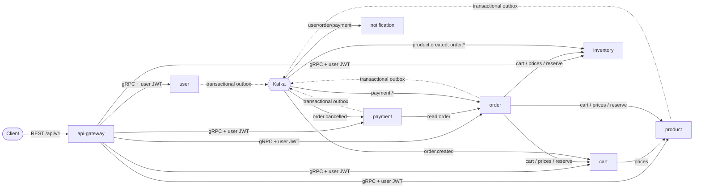

# VENDORA

An e-commerce backend built as Go microservices that talk over gRPC and Kafka. The project focuses on getting the hard parts right: money, stock, retries and partial failure.


## Architecture



| Service | Owns | Highlights |
|---|---|---|
| **api-gateway** `:8080` | — | Versioned REST, JWT auth, Redis rate limiting, RFC 9457 errors, body limits, CORS allowlist, OpenAPI at `/docs` |
| **user-service** | `users_db` | bcrypt, timing-safe login, 15-minute access tokens, rotating refresh tokens with reuse detection, admin bootstrap |
| **product-service** | `products_db` | Keyset pagination, PATCH semantics, soft delete, Redis cache-aside with `singleflight` |
| **cart-service** | Redis | Atomic Lua updates on Redis hashes, prices always read live from the catalog |
| **inventory-service** | `inventory_db` | All-or-nothing, idempotent reservations; database constraints make overselling impossible |
| **order-service** | `orders_db` | Checkout **saga** orchestrator, explicit state machine, `Idempotency-Key`, timeout sweeper |
| **payment-service** | `payments_db` | One payment per order, amount taken from the order, provider idempotency key, refund compensation |
| **notification-service** | `notifications_db` | Idempotent email delivery; events carry IDs only, no personal data |

### How a checkout works

1. `POST /api/v1/orders` (with `Idempotency-Key`) creates the order as `PENDING`, using prices from the catalog.
2. inventory-service reserves every line **in one transaction**. If any line is short, the order becomes `REJECTED`. If the outcome is unknown, the order becomes `CANCELLED`, and the `order.cancelled` event makes inventory release whatever was reserved.
3. The order moves to `AWAITING_PAYMENT`, and `order.created` is published through the outbox. cart-service then removes exactly the ordered lines.
4. `POST /api/v1/orders/{id}/payment` charges the order total. `payment.succeeded` moves the order to `CONFIRMED`, and inventory commits the stock.
5. A failed payment, a customer cancel, or the payment timeout moves the order to `CANCELLED` and releases the stock. A charge that succeeds after a timeout is refunded.

**Reliability.** Every state change is written in the same database transaction as its outbox event. Consumers commit Kafka offsets only after handling a message, retry with exponential backoff and jitter, send failures to `<topic>.dlq`, and skip duplicates using a `processed_events` table.

## Quick start

Prerequisites: Docker, plus Go 1.26 and Make for local development.

```bash
make env     # writes .env with random secrets and prints the admin login
make up      # builds and starts everything; services migrate their own schemas
```

- API: http://localhost:8080/api/v1 · OpenAPI UI: http://localhost:8080/docs (set `GATEWAY_PORT` in `.env` if 8080 is taken)
- `make dev` publishes Postgres, Redis and Kafka on 127.0.0.1 and adds Kafka UI on :8090.
- `make observability` adds Prometheus (127.0.0.1:9091) and Grafana (127.0.0.1:3001) with an alert rule set and a provisioned dashboard.

### Try it

```bash
API=http://localhost:8080/api/v1
ADMIN=$(curl -s $API/auth/login -d '{"email":"admin@vendora.local","password":"<from make env>"}' | jq -r .tokens.access_token)
PID=$(curl -s $API/admin/products -H "Authorization: Bearer $ADMIN" \
  -d '{"name":"Wireless Mouse","price_cents":2999,"initial_stock":10}' | jq -r .product.id)

USER=$(curl -s $API/auth/register -d '{"email":"ada@example.com","password":"correct-horse","first_name":"Ada","last_name":"L"}' | jq -r .tokens.access_token)
curl -s $API/cart/items -H "Authorization: Bearer $USER" -d "{\"product_id\":\"$PID\",\"quantity\":2}"
OID=$(curl -s $API/orders -H "Authorization: Bearer $USER" -H "Idempotency-Key: $(uuidgen)" | jq -r .order.id)
curl -s $API/orders/$OID/payment -H "Authorization: Bearer $USER" -d '{"payment_method_token":"tok_visa"}'
curl -s $API/orders/$OID -H "Authorization: Bearer $USER" | jq .order.status   # ORDER_STATUS_CONFIRMED
```

The built-in fake payment provider declines `tok_decline` and returns a transient error for `tok_error`.

## Development

```bash
make build      # go build ./...
make test       # unit tests
make test-race  # with the race detector (needs cgo; runs in CI)
make lint       # go vet + gofmt
make proto      # buf lint + buf generate (proto/vendora/<svc>/v1)
make e2e        # end-to-end tests against a running stack
```

Layout: `proto/` holds the contracts and `gen/` the generated code. `pkg/` is the shared platform: config, auth, gRPC server and client, database and migrations, Kafka, outbox, admin endpoints and lifecycle. Each `services/<name>` has `handler` (transport), `service` (domain logic), `repository` (storage) and `migrations`.

Every service also exposes an internal admin port (`:9090`) with `/livez`, `/readyz`, `/metrics` and `/debug/pprof`.

## Configuration

All settings come from environment variables. Services **refuse to start** if a required value is missing or malformed, and there are no secret defaults. See [`.env.example`](.env.example).

## Further reading

[`docs/VENDORA-ENGINEERING-IMPROVEMENT-ROADMAP.md`](docs/VENDORA-ENGINEERING-IMPROVEMENT-ROADMAP.md) has the original audit and the improvement roadmap, with an implementation-status section at the top.
