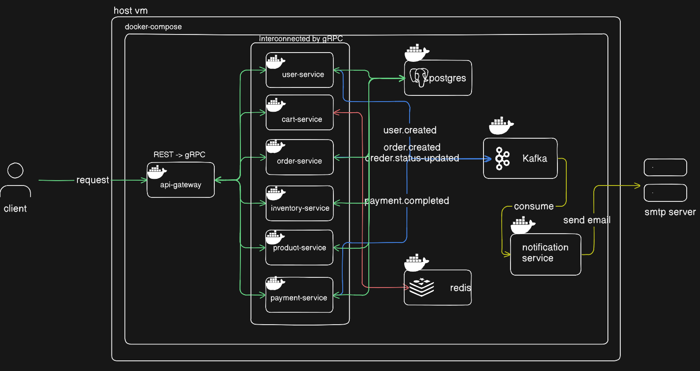

# ForgeCart

A production-ready **e-commerce microservices backend** built with Go, gRPC, and modern cloud-native technologies.


---

## Architecture

This project follows a **microservices architecture** where each service is independently deployable and communicates via gRPC. The API Gateway converts REST to gRPC.


---

## Services

| Service | Port | Description | Tech Stack |
|---------|------|-------------|------------|
| **API Gateway** | 8080 | REST API, routing, JWT auth, Swagger docs | Chi, JWT, Swagger |
| **User Service** | 50051 | Registration, login, authentication | gRPC, PostgreSQL, bcrypt |
| **Product Service** | 50052 | Product catalog CRUD operations | gRPC, PostgreSQL |
| **Cart Service** | 50053 | Shopping cart management | gRPC, Redis |
| **Order Service** | 50054 | Order creation and management | gRPC, PostgreSQL, Kafka |
| **Payment Service** | 50055 | Payment processing | gRPC, PostgreSQL |
| **Inventory Service** | 50056 | Stock level management | gRPC, PostgreSQL |
| **Notification Service** | — | Email notifications via Kafka events | Kafka Consumer, SMTP |

---

## Prerequisites

- **Docker** & **Docker Compose**
- **Go 1.24+** (for local development)
- **Make** (optional, for convenient commands)
- **Buf CLI** (for protobuf generation)

---

## Quick Start

### 1. Clone the repository

```bash
git clone https://github.com/ayushdevani/forgecart.git
cd forgecart
```

### 2. Set up environment variables

```bash
cp .env.example .env
# Edit .env with your configuration (SMTP, Stripe, etc.)
```

### 3. Start all services

```bash
make up
```

This will:
- Build all Go microservices
- Start PostgreSQL, Redis, Kafka, and Zookeeper
- Create necessary databases
- Launch all services with health checks

### 4. Verify services are running

```bash
docker-compose ps
```

### 5. Access the API

- **API Gateway**: http://localhost:8080
- **Swagger UI**: http://localhost:8080/swagger/index.html
- **Kafka UI**: http://localhost:8090
- **Health Check**: http://localhost:8080/health

---


---

## ⚙️ Configuration

### Environment Variables

| Variable | Description | Default |
|----------|-------------|---------|
| `JWT_SECRET` | Secret key for JWT tokens | `super-secret-jwt-key` |
| `POSTGRES_USER` | PostgreSQL username | `forgecart` |
| `POSTGRES_PASSWORD` | PostgreSQL password | `forgecart_pass` |
| `REDIS_URL` | Redis connection URL | `localhost:6379` |
| `KAFKA_BROKERS` | Kafka broker addresses | `localhost:9092` |
| `SMTP_HOST` | SMTP server host | - |
| `SMTP_PORT` | SMTP server port | `587` |
| `SMTP_USERNAME` | SMTP username | - |
| `SMTP_PASSWORD` | SMTP password | - |
| `EMAIL_FROM` | Sender email address | - |


---

## 🐳 Docker

### Build all services

```bash
docker-compose build
```

### View logs

```bash
# All services
docker-compose logs -f

# Specific service
docker-compose logs -f user-service
```

### Health Checks

All services include health checks. View status:

```bash
docker-compose ps
```

---

## Monitoring

- **Kafka UI**: http://localhost:8090
  - Monitor Kafka topics, consumers, and messages
  - View notification events in real-time

---

## Authentication

ForgeCart uses **JWT (JSON Web Tokens)** for authentication:

1. Register a new user via `/api/auth/register`
2. Login via `/api/auth/login` to receive a JWT token
3. Include the token in subsequent requests:
   ```
   Authorization: Bearer <your-jwt-token>
   ```