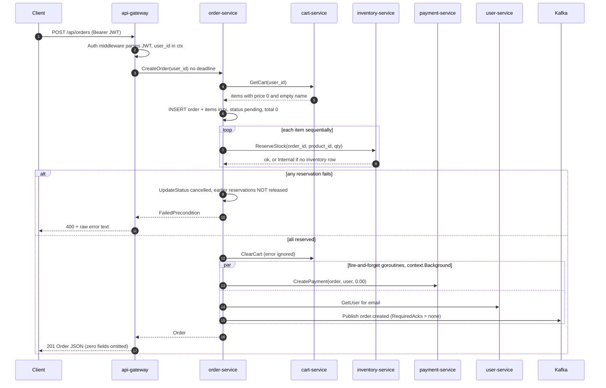
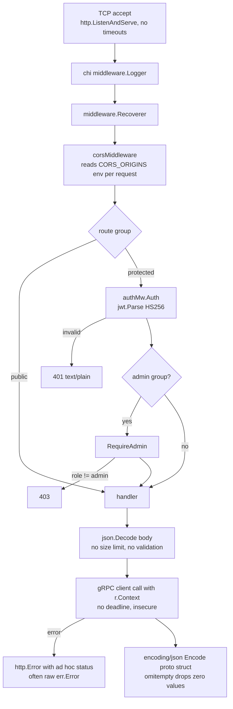
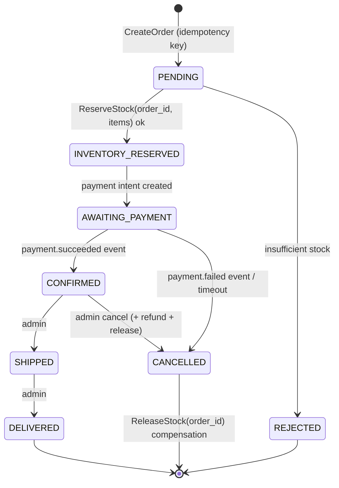
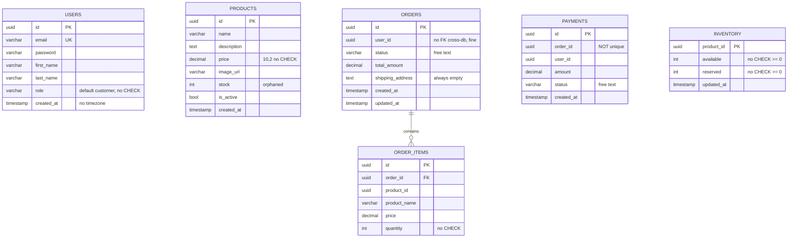
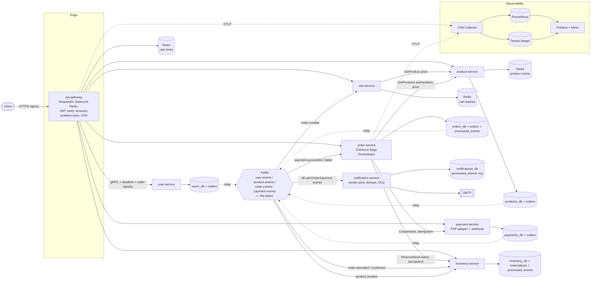
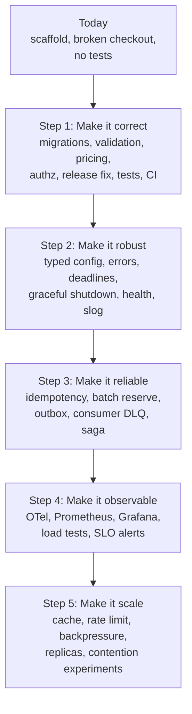

# VENDORA — Engineering Improvement Roadmap

> **Status:** Audit and plan only. No application code was changed while this was written.
> **Audit date:** 2026-11-07 · **Commit audited:** `da5fa85` (plus an uncommitted README rename)
> **Method:** Read every hand-written source file, proto, Dockerfile, the compose file, the Makefile and the scripts. Built and vetted every Go workspace module locally with Go 1.27.3. Checked library defaults in the module cache (`segmentio/kafka-go v0.4.50`, `golang-jwt/jwt/v5 v5.3.0`). Generated code in `gen/` was inspected but not audited line by line.

## Implementation Status (updated after the first implementation pass)

> The audit below (sections 1–17) describes the code **as it was at commit `da5fa85`**. Since then the codebase has been rebuilt: it was renamed to **VENDORA**, collapsed into a single Go module (`github.com/Varsh1l01/VENDORA`), and given versioned protos (`proto/vendora/<svc>/v1`). File references in the audit therefore point at the old layout.

| Status | Backlog items |
|---|---|
| ✅ Done | B-01 test target · B-02 migrations · B-03 CI (`.github/workflows/ci.yml`) · B-04 authoritative pricing · B-05 validation · B-06 DB constraints · B-07 ownership checks · B-08 order-derived, unique payments · B-09 secrets fail-fast + pinned JWT · B-10 exact-quantity release · B-11 state machine · B-12 inventory provisioning (`product.created`) · B-14 timeouts/deadlines · B-15 admin bootstrap + admin routes · B-16 typed config · B-17 error model + problem+json · B-18 no ignored errors · B-19 domain logic out of handlers · B-20 idempotency key · B-21 batch idempotent reservation · B-22 outbox · B-23 reliable consumers + DLQ + dedupe · B-24 checkout saga · B-25 graceful shutdown · B-26 health/readiness · B-27 slog · B-28 service identity + default-deny RPC policy · B-29 rate limiting · B-30 `/api/v1`, protojson, versioned protos, `buf breaking` in CI · B-31 timestamps · B-32 integer money · B-34 Prometheus metrics, dashboard, alerts · B-35 Redis-hash cart · B-36 keyset pagination + indexes · B-37 product cache · B-41 saga sweeper · B-43 refresh tokens · B-44 Dockerfile hardening · B-45 govulncheck in CI · B-46 compose split, KRaft, Redis auth · B-47 pprof on admin port · B-50 provider adapter (fake) · B-51 status history · B-52 dead protos removed · B-53 rename |
| 🟡 Partial | B-13 tests: unit tests for auth, errors, validation, config, gRPC policy, gateway, the order saga, user and cart, plus a Go e2e suite (`tests/e2e`, run by CI). Testcontainers repository tests are still missing. · B-38 the e2e suite includes a concurrent no-oversell test, but there is no k6 suite yet · B-42 compensation paths are tested, but there is no Toxiproxy fault injection yet |
| ❌ Open | B-33 OpenTelemetry tracing · B-39 circuit breakers (retries for idempotent RPCs are done) · B-40 notification worker pool · B-48 hot-SKU contention experiment · B-49 replica-scaling demo · B-54 Kubernetes · B-55 ADRs |

### How to read this document

| Marker | Meaning |
|---|---|
| ✅ **Implemented** | Works as intended in the source code |
| 🟡 **Partial** | Exists, but incomplete or missing important paths |
| ❌ **Missing** | Not present in the code (even if the README claims it) |
| 🔴 **Incorrect** | Present, but behaves wrongly or unsafely |
| **[Verified]** | Confirmed by running a command or reading library source |
| **[Assumption]** | Inferred, not confirmed by running the full stack |

File references use `path:line` and are relative to the repository root.

---

## Table of Contents

1. [Executive Summary](#1-executive-summary)
2. [Complete Existing Architecture Analysis](#2-complete-existing-architecture-analysis)
3. [Existing Features Audit](#3-existing-features-audit)
4. [Backend Engineering Improvements](#4-backend-engineering-improvements)
5. [Advanced Go Engineering](#5-advanced-go-engineering)
6. [Distributed Systems Improvements](#6-distributed-systems-improvements)
7. [Database and Caching Improvements](#7-database-and-caching-improvements)
8. [Performance and Scalability](#8-performance-and-scalability)
9. [Security Audit](#9-security-audit)
10. [Observability and Monitoring](#10-observability-and-monitoring)
11. [Testing Strategy](#11-testing-strategy)
12. [Infrastructure and DevOps](#12-infrastructure-and-devops)
13. [System Design Concepts We Can Demonstrate](#13-system-design-concepts-we-can-demonstrate)
14. [Architecture Evolution Proposal](#14-architecture-evolution-proposal)
15. [Prioritized Improvement Backlog](#15-prioritized-improvement-backlog)
16. [Implementation Roadmap](#16-implementation-roadmap)
17. [Final Engineering Assessment](#17-final-engineering-assessment)

---

## 1. Executive Summary

### What VENDORA currently does

VENDORA is an e-commerce backend made of Go microservices. A REST API gateway (chi) turns HTTP requests into gRPC calls to six backend services: user, product, cart, order, payment and inventory. A seventh service, notification, reads JSON events from a single Kafka topic and sends emails over SMTP, or only logs them when SMTP is turned off.

Go module paths, email templates and Swagger metadata still say **ForgeCart** (`github.com/ayushdevani/forgecart/...`). The project appears to be derived from an upstream "forgecart" repository. **[Assumption]**

### Architectural style

- **Microservices with a database per service.** Postgres hosts one database per service inside a single Postgres instance. The cart lives in Redis.
- **Synchronous gRPC orchestration.** `order-service` calls cart, inventory, payment and user. `payment-service` calls order and user, so order and payment depend on each other in a cycle.
- **Fire-and-forget events.** Services publish to Kafka from detached goroutines. There is one topic (`notifications`) with one consumer (notification-service).
- **Handler → Service → Repository layering** in every service. Business orchestration in order and payment sits in the gRPC handler layer, not the service layer.

### Technology stack (verified from `go.mod` files)

| Concern | Technology |
|---|---|
| Language | Go 1.24 (`go.work`); Docker builds on `golang:1.24-alpine` |
| HTTP | `go-chi/chi/v5 v5.2.4`, `swaggo/http-swagger` |
| RPC | `google.golang.org/grpc v1.78.0`, protobuf (`buf` generation) |
| SQL | `jackc/pgx/v5 v5.8.0` (`pgxpool`) on PostgreSQL 15 |
| Cache/KV | `redis/go-redis/v9 v9.17.2` on Redis 7 |
| Messaging | `segmentio/kafka-go v0.4.50` on Confluent Kafka 7.5 + Zookeeper |
| Auth | `golang-jwt/jwt/v5` (HS256), `golang.org/x/crypto/bcrypt` |
| Runtime | Docker Compose |

### Engineering maturity — honest assessment

The decomposition is sensible, the layering is consistent, and some details are right: atomic conditional stock decrement, transactional order insert, a `pgx` connection pool, and `grpc.NewClient`. **The core business flow does not work correctly, though, and the system does not work out of the box:**

1. **Database migrations are never applied.** [Verified] Nothing reads `services/*/migrations/*.sql`. No migration tool is invoked, and `docker-compose.yml` mounts only `scripts/create-databases.sh`, which creates empty databases. On a fresh `make up`, every SQL query fails with "relation does not exist".
2. **Cart items never get a name or price.** `services/cart-service/handler/cart_handler.go:32-35` stores only `ProductID` and `Quantity`, and `PRODUCT_SERVICE_ADDR` is configured but never read. So every cart total, order total and payment amount is `0`.
3. **Checkout fails, or leaks stock.** No inventory rows are ever created for products, and the endpoint that could create them (`UpdateStock`) is not routed. Partial reservations are not rolled back. `ReleaseStock` always releases exactly one unit (`services/inventory-service/service/inventory_service.go:53`). Negative quantities are accepted, which **inflates** stock.
4. **The payment lifecycle cannot finish through the API.** `UpdatePaymentStatus` is not routed. Status strings disagree (`"completed"` in code vs `succeeded` in the proto). Two payments are created for every order.
5. **There are broken-object-level-authorization (IDOR) holes.** Any authenticated user can read any order or payment by ID, and can create a payment for any order with any amount.
6. **There are zero tests**, and `make test` fails under `go.work`. [Verified]
7. **Observability is minimal.** Logging is unstructured `log.Printf`. There are no metrics, no tracing, no correlation IDs, and the gRPC services have no health checks.

**Bottom line:** VENDORA is a well-organized *scaffold* of a microservice system, not a production-grade backend. Fixing correctness and security comes before anything else. Only after that do distributed-systems patterns (outbox, saga, idempotency) become meaningful. Coincidentally, those patterns are also the right fix for several of today's bugs.

---

## 2. Complete Existing Architecture Analysis

### 2.1 Project structure

```
ForgeCart/
├── go.work                     # Go workspace: gen, pkg, 8 service modules
├── buf.yaml / buf.gen.yaml     # protobuf generation (protoc-gen-go, protoc-gen-go-grpc)
├── proto/*.proto               # 7 proto files, package names unversioned (cart, order, ...)
├── gen/                        # generated Go code, its own module
├── pkg/                        # shared module
│   ├── config/config.go        # GetEnv/GetEnvInt/GetEnvBool
│   ├── health/health.go        # static {"status":"ok"} HTTP handler
│   ├── kafka/producer.go       # Event envelope + Writer wrapper
│   ├── kafka/consumer.go       # Reader loop wrapper
│   └── middleware/auth.go      # JWT HTTP middleware + RequireAdmin
├── services/
│   ├── api-gateway/            # chi router, REST→gRPC handlers, swagger docs
│   ├── user-service/           # handler/service/repository + migrations
│   ├── product-service/        # handler/service/repository + migrations
│   ├── cart-service/           # handler/service/repository (Redis)
│   ├── order-service/          # handler/service/repository + migrations
│   ├── payment-service/        # handler/service/repository + migrations
│   ├── inventory-service/      # handler/service/repository + migrations
│   └── notification-service/   # Kafka consumer + email package
├── scripts/create-databases.sh # Postgres init: creates 6 databases
├── docker-compose.yml          # 8 app services + postgres, redis, zookeeper, kafka, kafka-ui
└── Makefile
```

### 2.2 Go modules and dependencies

- There are 10 modules, all tied together by `go.work`. Service `go.mod` files do **not** `require` `gen` or `pkg`. They resolve only through workspace mode, so a service cannot be built outside the workspace (for example with `GOWORK=off`). `services/notification-service/go.mod` has no `require` block at all.
- The Dockerfiles copy the whole repository (`COPY . .`) so the workspace resolves inside the container. That works, but it invalidates the build cache whenever any file changes.
- [Verified] `go build ./...` and `go vet ./...` pass for every module when run per module.
- [Verified] `go test ./...` from the repository root fails: `pattern ./...: directory prefix . does not contain modules listed in go.work`. That is exactly what `Makefile:76` runs.
- `Makefile:80-82` installs `@latest` tool versions, so builds are not reproducible.

### 2.3 Service boundaries

| Service | Store | Inbound | Outbound calls | Publishes |
|---|---|---|---|---|
| api-gateway | — | HTTP :8080 | user, product, cart, order, payment, inventory | — |
| user-service | `users_db` | gRPC :50051 | — | `user.registered` |
| product-service | `products_db` | gRPC :50052 | — | — |
| cart-service | Redis | gRPC :50053 | **none** (product address configured but unused) | — |
| order-service | `orders_db` | gRPC :50054 | cart, inventory, payment, user | `order.created`, `order.status.updated` |
| payment-service | `payments_db` | gRPC :50055 | order, user | `payment.completed` |
| inventory-service | `inventory_db` | gRPC :50056 | — | — |
| notification-service | — (`notifications_db` created, unused) | Kafka `notifications` | SMTP | — |

**Boundary problems:**

- **Two sources of truth for stock.** `products.stock` (`product.proto` field 6, written by `CreateProduct` and `UpdateProduct`) and `inventory.available` are never synchronized.
- **Cyclic dependency between order and payment.** `order_handler.go:134` calls `PaymentService.CreatePayment`, and `payment_handler.go:72` calls `OrderService.UpdateOrderStatus`.
- **Order and payment call user-service only to get an email address** for notifications. That couples the checkout path to user-service availability. Those calls happen in background goroutines, so the coupling is to *notification correctness*, not to checkout latency.
- `NotificationService` is defined in `proto/notification.proto` and generated, but **no server implements it**.

### 2.4 Internal package organization

Every service has the same `handler/`, `service/` and `repository/` layout. Good:

- Repositories hide SQL and Redis details.
- Sentinel errors (`ErrProductNotFound` etc.) are defined in the service layer.

Weaknesses:

- **Concrete types everywhere.** `service.UserService` holds `*repository.UserRepository` and handlers hold `*service.XService`. Nothing can be swapped for a fake, which is part of why there are no tests.
- **Domain logic sits in transport handlers.** `order_handler.go` contains the entire checkout orchestration: fetch cart, reserve, clear, pay, publish. `payment_handler.go` contains the confirm-order side effect.
- **Repository structs double as domain models and DTOs.** For example, `repository.User` carries the password hash up into the service layer.

### 2.5 API design

| Method | Path | Auth | Handler | Notes |
|---|---|---|---|---|
| GET | `/health` | none | `health.Handler` | static OK |
| GET | `/swagger/*` | none | http-swagger | |
| POST | `/api/auth/register` | none | `handlers.Register` | |
| POST | `/api/auth/login` | none | `handlers.Login` | |
| GET | `/api/products` | none | `handlers.ListProducts` | page/limit |
| GET | `/api/products/{id}` | none | `handlers.GetProduct` | |
| GET | `/api/inventory/{productId}` | none | `handlers.GetStock` | |
| GET | `/api/cart` | JWT | `handlers.GetCart` | |
| POST | `/api/cart/items` | JWT | `handlers.AddToCart` | |
| DELETE | `/api/cart/items/{productId}` | JWT | `handlers.RemoveFromCart` | |
| POST | `/api/orders` | JWT | `handlers.CreateOrder` | |
| GET | `/api/orders` | JWT | `handlers.ListOrders` | |
| GET | `/api/orders/{id}` | JWT | `handlers.GetOrder` | **no ownership check** |
| POST | `/api/payments` | JWT | `handlers.CreatePayment` | **client-supplied amount** |
| GET | `/api/payments/order/{orderId}` | JWT | `handlers.GetPayment` | **no ownership check** |
| POST | `/api/products` | JWT + admin | `handlers.CreateProduct` | |

These exist but are **not routed**, although Swagger documents them:

- `handlers.UpdateStock` (`services/api-gateway/handlers/inventory.go:53`), documented as `PUT /api/inventory/{productId}`.
- `handlers.UpdatePaymentStatus` (`handlers/payment.go:100`), documented as `PUT /api/payments/{id}/status`.

These gRPC RPCs have no gateway route at all: `UpdateProduct`, `DeleteProduct`, `UpdateOrderStatus`, `ClearCart`, `ValidateToken`, `GetUser`.

**Design observations:**

- There is no versioning (`/api/...`, not `/api/v1/...`). Proto packages are unversioned too (`package cart;`, not `vendora.cart.v1`).
- Responses are generated proto structs encoded with `encoding/json`. Generated structs carry `json:"...,omitempty"` tags [Verified in `gen/cart.pb.go:104`], so **zero values vanish from responses**: `total: 0`, `success: false` and `is_active: false` are all dropped. The API contract is effectively "whatever protoc emits", and proto changes leak straight into the REST contract.
- Errors are plain text from `http.Error`. Some handlers echo raw gRPC error strings (`handlers/auth.go:49`, `cart.go:70`, `payment.go:51`). Status mapping is ad hoc: `Register` returns 400 for every failure, including internal ones.
- Money is `double` in the protos and `float64` in Go, but `DECIMAL(10,2)` in SQL.
- Order and payment `status` fields are free-form strings, not enums.

### 2.6 gRPC communication

- Every client uses `insecure.NewCredentials()` (`api-gateway/main.go:136`, `order_handler.go:40-58`, `payment_handler.go:32-37`). There is no TLS and no per-call credentials.
- Every server is a bare `grpc.NewServer()`. There are no interceptors (logging, recovery, metrics, auth, validation), no keepalive settings, no `grpc.health.v1` service, no reflection, and no `GracefulStop`.
- **No deadlines.** The gateway passes `r.Context()`, which has no timeout because `http.ListenAndServe` sets none. Background calls use `context.Background()`. A hung downstream service holds a goroutine and a connection forever.
- There are no retry or service-config policies. `grpc.NewClient` connects lazily, which is good, so startup order does not matter.
- Inventory reservation is **N sequential unary RPCs**, one per cart item (`order_handler.go:105-120`).

### 2.7 Protocol Buffers

- `buf.yaml` sets no lint or breaking-change rules beyond the defaults. `make proto-lint` exists but nothing runs it.
- There are no `google.protobuf.Timestamp` types (`created_at` is a `string`), no money type, no enums, no field validation (for example `protovalidate`), and no idempotency or request-ID fields.
- `CreateOrderRequest` has only `user_id`. There is no shipping address, although `orders.shipping_address` exists and is always written as `""` (`order_handler.go:168`).

### 2.8 Database integration

- Each repository calls `pgxpool.New(context.Background(), dbURL)` with default pool settings. **There is no `Ping`**, and `pgxpool.New` does not connect eagerly, so the `log.Fatalf("Failed to connect to database")` branch effectively never fires for an unreachable database. Failures show up later, on the first request.
- Queries are parameterized everywhere, so SQL injection is not present. ✅
- Transactions are used in only one place, `OrderRepository.Create`, which correctly inserts the order and its items atomically. ✅
- Errors from `rows.Scan`, `rows.Err()` and `COUNT(*)` are ignored (`product_repository.go:64,81`, `order_repository.go:102,113,129`).
- `OrderRepository.ListByUserID` never loads order items, so `GET /api/orders` returns orders with empty `items`.

### 2.9 Authentication and authorization

- **Issuing tokens:** `user_service.go:129-138` signs HS256 tokens with claims `user_id`, `email`, `role` and `exp` (24 hours). There is no `iss`, `aud`, `iat`, `jti`, refresh token or revocation.
- **Validating tokens:** `pkg/middleware/auth.go:33` calls `jwt.Parse` without `jwt.WithValidMethods`. The key func returns `[]byte`, so RS/ES algorithm-confusion and `none` attacks fail in practice with jwt/v5, but the algorithm is not pinned explicitly. `UserService.ValidateToken` duplicates the same logic and is never called.
- **Authorization:** the only rule is `RequireAdmin` (role must equal `"admin"`). **No code path can produce an admin**: `Register` hard-codes `"customer"` (`user_service.go:54`), and no endpoint, seed or CLI promotes a user. Admin routes can only be reached by editing the database by hand.
- **Resource ownership:** enforced only where the gateway injects `user_id` from the token (cart, order list). It is not enforced on `GetOrder` or `GetPayment`.
- **Service-to-service:** none. Backend services trust any `user_id` in the request.

### 2.10 Configuration management

- `pkg/config` reads environment variables with fallback defaults. Defaults include **credentials and the JWT secret** (`super-secret-jwt-key` in `api-gateway/main.go:49`, `user-service/main.go:21` and `docker-compose.yml:20,36`).
- Nothing is validated at startup, and there is no typed config struct. `GetEnvInt` and `GetEnvBool` silently fall back to the default when parsing fails.
- **Names are inconsistent:**
  - `.env.example` uses `SMTP_USER`/`SMTP_PASS`, but the code reads `SMTP_USERNAME`/`SMTP_PASSWORD` (`email_service.go:26-27`).
  - Compose sets `EMAIL_FROM`, but the code reads `SMTP_FROM` (`email_service.go:28`).
  - The README documents `EMAIL_FROM`.
  - Compose sets `SERVER_PORT=8080`, but the gateway reads `API_GATEWAY_PORT`.
  - `POSTGRES_MULTIPLE_DATABASES` is set but ignored, because `create-databases.sh` hard-codes the list.
  - `STRIPE_SECRET_KEY` is in `.env.example`, but no code uses it.
- notification-service passes `KAFKA_BROKERS` as a single element (`[]string{brokers}`, `notification-service/main.go:51`), while the other services split on commas.

### 2.11 Error handling

- Sentinel errors are compared with `==`, not `errors.Is`. That works today only because nothing wraps errors.
- **Masking:** every repository error becomes `NotFound` (`product_service.go:40-44`, `order_service.go:43-48`, `payment_service.go:36-42`, `inventory_service.go:23-29`, `user_handler.go:79-82`). A database outage is reported as "not found".
- **Leaking:** `status.Error(codes.Internal, err.Error())` returns raw pgx and Redis error text to callers, and the gateway sometimes forwards it to HTTP clients.
- **Wrong codes:** `inventory_handler.go:51-56` maps `ErrStockNotFound` to `Internal`, and a duplicate-email race in `Register` comes back as `Internal`.

### 2.12 Logging

- The standard library `log.Printf` everywhere. There are no levels, no structure, and no request or trace IDs.
- The gateway uses chi `middleware.Logger`. The gRPC services log nothing per request.
- `email_service.go:36` logs full email bodies, including recipient addresses (PII), when SMTP is disabled.

### 2.13 Middleware

- Gateway chain: `middleware.Logger` → `middleware.Recoverer` → `corsMiddleware` → (group) `authMw.Auth` → (group) `RequireAdmin`.
- Missing: `RequestID`, real-IP handling, timeouts, body-size limits, rate limiting, security headers, gzip, metrics and tracing.
- `corsMiddleware` (`api-gateway/main.go:144-166`) re-reads and re-splits `CORS_ORIGINS` on every request. With the default `*` it **reflects any Origin** and sends no `Vary: Origin`.

### 2.14 Docker and deployment

- Every service has a two-stage Dockerfile (`golang:1.24-alpine` → `alpine:latest`). ✅ Weaknesses:
  - `alpine:latest` is unpinned.
  - The container runs as root.
  - There is no `.dockerignore`, and `COPY . .` busts the cache on any change.
  - The build has no `-trimpath -ldflags="-s -w"` and no `HEALTHCHECK`.
- Compose: infrastructure services have health checks ✅. **Application services have none**, although the README says "Launch all services with health checks". Postgres, Redis, Zookeeper and Kafka ports are published to the host, Redis has no password, and `kafka-ui:latest` is exposed on 8090 without authentication. Compose also uses the deprecated `version:` key.
- There is no CI/CD, no `.github/`, and no linting configuration.

### 2.15 Testing infrastructure

- **No `_test.go` files exist.** [Verified: `find . -name "*_test.go" | wc -l` → 0]
- There are no test helpers, fixtures, Testcontainers or mocks, and `make test` is broken (see §2.2).

### 2.16 Current architecture diagram

```mermaid
flowchart LR
    Client([HTTP Client]) -->|REST/JSON :8080| GW[api-gateway<br/>chi + JWT]

    GW -->|gRPC insecure| US[user-service]
    GW -->|gRPC| PS[product-service]
    GW -->|gRPC| CS[cart-service]
    GW -->|gRPC| OS[order-service]
    GW -->|gRPC| PayS[payment-service]
    GW -->|gRPC| IS[inventory-service]

    OS -->|GetCart / ClearCart| CS
    OS -->|ReserveStock / ReleaseStock| IS
    OS -->|CreatePayment async| PayS
    OS -->|GetUser email async| US
    PayS -->|UpdateOrderStatus async| OS
    PayS -->|GetUser email async| US

    US --> UDB[(users_db)]
    PS --> PDB[(products_db)]
    OS --> ODB[(orders_db)]
    PayS --> PayDB[(payments_db)]
    IS --> IDB[(inventory_db)]
    CS --> R[(Redis)]

    US -. user.registered .-> K{{Kafka topic: notifications}}
    OS -. order.created / order.status.updated .-> K
    PayS -. payment.completed .-> K
    K -. consumer group .-> NS[notification-service] --> SMTP[[SMTP or log]]

    subgraph Postgres single instance
      UDB
      PDB
      ODB
      PayDB
      IDB
    end
```

### 2.17 Service interaction — checkout as implemented



### 2.18 Request lifecycle (gateway)



### 2.19 Existing data flow

| Data | Written by | Read by | Consistency mechanism |
|---|---|---|---|
| User + password hash | user-service `Create` | user-service, order/payment via `GetUser` | single DB row; `UNIQUE(email)` |
| Product catalog | product-service | gateway; **not** cart | none |
| `products.stock` | product-service | nobody downstream | **orphaned**, diverges from inventory |
| Inventory `available/reserved` | inventory-service | order-service | conditional `UPDATE` (atomic per row) |
| Cart | cart-service (Redis JSON list, no TTL) | order-service | none; read-modify-write race |
| Order + items | order-service (tx) | gateway, payment | single transaction |
| Payment | payment-service + gateway + order-service | gateway | none; duplicates possible |
| Notification events | user/order/payment goroutines | notification-service | none; at-most-once on both sides |

---

## 3. Existing Features Audit

| Feature | Current Status | Evidence/File | Problems | Improvement |
|---|---|---|---|---|
| User registration | 🟡 Partial | `user-service/service/user_service.go:35-82` | No email format/normalization, no password policy; TOCTOU between `GetByEmail` and `Create`; a unique-violation race returns `Internal`; event published from a detached goroutine; no admin bootstrap | Validate and normalize input; rely on the unique constraint and map pg `23505` to `AlreadyExists`; outbox event; admin seed/CLI |
| Login | 🟡 Partial | `user_service.go:84-103` | No rate limit or lockout; timing difference between unknown user and wrong password; 24h token, no refresh | Rate limit per IP+email; constant-time path with a dummy hash; short access token + refresh token |
| JWT validation | 🟡 Partial | `pkg/middleware/auth.go:18-54` | Algorithm not pinned; no `iss`/`aud`; `ValidateToken` RPC duplicated and unused | `jwt.WithValidMethods(["HS256"])`, `WithIssuer`, `WithAudience`; one shared token package |
| RBAC | 🔴 Incorrect | `auth.go:70-79`, `user_service.go:54` | No way to create an admin; single hard-coded role check; no resource ownership checks | Role/permission model, admin seed, ownership checks in services |
| Product list/get | 🟡 Partial | `product-service/repository/product_repository.go:46-86` | `GetByID` returns inactive products; COUNT/Scan errors ignored; OFFSET pagination; `limit>100` silently resets to 10 | Filter `is_active`, check errors, keyset pagination, clamp limit to max |
| Product create | 🟡 Partial | `product_service.go:22-37` | No validation (empty name, negative price); writes `stock` that inventory never sees; unreachable without an admin | Validate; drop `stock` from product or emit `product.created` to seed inventory |
| Product update/delete | ❌ Missing at API | `product_handler.go:60-79` implemented, not routed | Update is full-overwrite (zeroes omitted fields); delete is a hard `DELETE` that orphans inventory/order references | Route under admin; PATCH semantics with field masks; soft delete |
| Cart get/add/remove | 🔴 Incorrect | `cart-service/handler/cart_handler.go:31-43`, `service/cart_service.go:21-67` | **Name/price never populated → total always 0**; no product existence check; zero/negative quantity accepted; lost-update race; no TTL | Look up product price via product-service; validate qty>0 and ≤ max; atomic Redis hash ops or WATCH/MULTI; TTL |
| Clear cart | 🟡 Partial | `cart_handler.go:54-61` | Not exposed at gateway; error ignored in checkout (`order_handler.go:181`) | Clear on `order.created` event idempotently |
| Create order (checkout) | 🔴 Incorrect | `order-service/handler/order_handler.go:145-200` | Total 0; orchestration in handler; partial reservations not compensated; double-click creates two orders; payment and event in fire-and-forget goroutines; product IDs that are not UUIDs cause `Internal` | Saga in service layer, batch reserve in one DB tx, idempotency key, outbox |
| Get order | 🔴 Incorrect | `api-gateway/handlers/order.go:88-100`, `order_handler.go:202-211` | **No ownership check (IDOR)** | Pass caller `user_id`, enforce `order.user_id == caller` or admin |
| List orders | 🟡 Partial | `order_repository.go:109-134` | Items never loaded; COUNT/Scan errors ignored; OFFSET pagination | Batch-load items (`WHERE order_id = ANY($1)`), keyset pagination |
| Update order status | 🔴 Incorrect | `order_service.go:61-66`, `order_handler.go:230-264` | Any string accepted; no state machine; repeated `cancelled` releases stock repeatedly; no "row not found" check; not routed | Explicit state machine with a conditional `UPDATE ... WHERE status = $from` |
| Inventory get | 🟡 Partial | `inventory_handler.go:21-35` | Public endpoint exposes `reserved` counts | Return only availability publicly |
| Inventory update | 🔴 Incorrect | `inventory_repository.go:42-52`, `handlers/inventory.go:53` unrouted | Overwrites `available` ignoring `reserved`; no auth because it is unrouted; the only way to create inventory rows | Admin route; "adjust by delta" semantics; auto-create on `product.created` |
| Reserve stock | 🟡 Partial | `inventory_service.go:35-50`, `inventory_repository.go:54-67` | Atomic conditional update ✅, but negative qty inflates stock; `order_id` ignored, so not idempotent; missing row → `Internal` | `CHECK (quantity > 0)`; reservations table keyed `(order_id, product_id)`; batch reserve |
| Release stock | 🔴 Incorrect | `inventory_service.go:52-54` | **Always releases 1 unit**; `order_id` ignored; can drive `reserved` negative; not idempotent | Release exactly the reserved row's quantity, once, by `(order_id, product_id)` |
| Create payment | 🔴 Incorrect | `api-gateway/handlers/payment.go:36-59`, `payment_handler.go:82-96`, `order_handler.go:184` | **Client sets amount and order**; created twice per order (gateway + order-service); no order existence/ownership check; no `UNIQUE(order_id)` | Payment created only by the saga; amount from the order; idempotency key; unique constraint |
| Payment status update | 🔴 Incorrect | `payment_handler.go:117-150`, `handlers/payment.go:100` unrouted | Not reachable; magic `"completed"` vs proto `succeeded`; no transition rules; confirms order in a detached goroutine | Webhook/simulated PSP endpoint with signature, state machine, event-driven order confirmation |
| Get payment by order | 🔴 Incorrect | `payment_repository.go:45-56` | IDOR; returns an arbitrary row when duplicates exist | Ownership check; unique per order |
| Stripe integration | ❌ Missing | only `STRIPE_SECRET_KEY` in `.env.example` | README implies it | Optional: PSP adapter interface + fake provider |
| Notifications | 🟡 Partial | `notification-service/main.go:67-113`, `pkg/kafka/consumer.go` | At-most-once (`ReadMessage` auto-commits before handling) [Verified]; no retry/DLQ; no dedupe; config name mismatches; SMTP header injection via unvalidated email; tight error loop without backoff | `FetchMessage`+`CommitMessages` after success, retry with backoff, DLQ, idempotency table in `notifications_db` |
| NotificationService gRPC | ❌ Missing | `proto/notification.proto` | Generated but unimplemented | Delete, or implement only if a sync use case exists |
| Health checks | 🟡 Partial | `pkg/health/health.go` (gateway only) | Static OK, no dependency checks; gRPC services have none; no compose health checks for apps | `grpc.health.v1` + `/livez` `/readyz` with dependency probes |
| Graceful shutdown | 🔴 Incorrect | `api-gateway/main.go:122-128` (`os.Exit(0)`), other services none | In-flight requests dropped; deferred `Close()` never runs on `log.Fatalf` | `http.Server.Shutdown`, `grpc.Server.GracefulStop`, ordered teardown |
| Swagger docs | 🟡 Partial | `api-gateway/main.go:26-45`, `docs/` | Host hard-coded to `shop.launch-pad.dev` https; documents unrouted endpoints; generic `map[string]interface{}` schemas | Typed response DTOs; configurable host; generate in CI and diff |
| DB migrations | ❌ Missing (runtime) | `services/*/migrations/*.sql` exist, nothing runs them [Verified] | Fresh environments have no tables | `golang-migrate` or `goose` per service, run as a step or init container |

---

## 4. Backend Engineering Improvements

Each item lists **Problem → Solution → Components → Complexity (S/M/L) → Benefit**.

### 4.1 API design and versioning
- **Problem:** No version prefix. The REST contract is the raw proto structs (`omitempty` drops `total: 0`). Admin CRUD routes are missing, and the docs list routes that do not exist.
- **Solution:** Mount routes under `/api/v1`. Add explicit gateway response DTOs, or use `protojson` with `EmitUnpopulated: true` and `UseProtoNames: true`. Version the proto packages (`vendora.order.v1`) and enable `buf breaking` against `main`. Route the missing admin endpoints (product update/delete, inventory adjust, order status).
- **Components:** `services/api-gateway/main.go`, `handlers/*`, `proto/*`, `buf.yaml`.
- **Complexity:** M · **Benefit:** A stable, evolvable contract, and generated docs that match reality.

### 4.2 Request validation
- **Problem:** No validation anywhere. Negative quantities, negative prices, empty names, invalid emails and non-UUID IDs all reach the database or Redis.
- **Solution:** Validate at both edges. In the gateway, a small `Validate()` method per request DTO, or `go-playground/validator`. In the services, `protovalidate` annotations in the protos plus a validation interceptor, so internal callers are also protected. Use `http.MaxBytesReader` and `DisallowUnknownFields`.
- **Components:** `handlers/*.go`, all `proto/*.proto`, a new `pkg/grpcx` interceptor.
- **Complexity:** M · **Benefit:** Closes the stock-inflation bug class (§9 S-03) and gives clean 400/`InvalidArgument` responses.

### 4.3 Response consistency and error handling
- **Problem:** Plain-text errors, ad hoc status codes, raw internal error text, NotFound masking real failures.
- **Solution:**
  - A single `pkg/apperr` with typed domain errors (`NotFound`, `Conflict`, `Invalid`, `Unauthorized`, `Forbidden`, `Unavailable`) that wrap causes with `%w`.
  - A gRPC interceptor that maps them to `codes.*` and **logs** internal errors without returning their text.
  - In the gateway, one `writeError(w, err)` that maps gRPC codes to HTTP statuses and emits RFC 9457 `application/problem+json` with `request_id`.
  - Repositories distinguish `pgx.ErrNoRows` from other errors.
- **Components:** every `handler/*.go`, every `service/*.go`, every `repository/*.go`, gateway handlers.
- **Complexity:** M · **Benefit:** Correct client behavior, no information leaks, and errors that can be debugged.

### 4.4 Middleware architecture
- **Problem:** The gateway has a minimal chain, and the gRPC services have none.
- **Solution:**
  - Gateway: `RequestID` → `RealIP` → structured access log → `Recoverer` → `Timeout` → body limit → CORS (parsed once at startup) → rate limit → auth → handler.
  - gRPC: chained unary interceptors for recovery → logging → metrics → tracing → auth (service identity) → validation.
- **Components:** `api-gateway/main.go`, new `pkg/httpx`, `pkg/grpcx`.
- **Complexity:** M · **Benefit:** Cross-cutting concerns in one place, applied uniformly.

### 4.5 Authentication
- **Problem:** Default secret, unpinned algorithm, no issuer/audience, no refresh or revocation, duplicated validation code.
- **Solution:**
  - One `pkg/auth` token issuer/verifier used by both user-service and the gateway.
  - Fail startup when `JWT_SECRET` is missing or shorter than 32 bytes.
  - 15-minute access tokens plus rotating refresh tokens stored hashed in `users_db`, with a revocation list keyed by `jti`.
  - Optionally move to EdDSA/RS256 with a JWKS endpoint so that only user-service holds the private key.
- **Components:** `pkg/middleware/auth.go`, `user-service/service/user_service.go`, `user.proto`.
- **Complexity:** M · **Benefit:** Removes a high-severity misconfiguration and shows real token lifecycle design.

### 4.6 Authorization and RBAC
- **Problem:** No admin bootstrap, no ownership checks, no internal-only RPC protection.
- **Solution:**
  - Roles `customer` / `admin`, plus an internal `service` principal.
  - Ownership checks **inside the owning service** (order-service verifies `order.user_id == caller`), not just in the gateway.
  - Propagate the caller identity in gRPC metadata from the gateway, verified by an interceptor.
  - Mark internal RPCs (`UpdateOrderStatus`, `UpdatePaymentStatus`, `ReserveStock`) as service-only.
  - Add an admin seed through a migration or a `vendoractl` CLI.
- **Components:** gateway handlers, order/payment handlers, `pkg/auth`.
- **Complexity:** M · **Benefit:** Fixes the IDOR findings and the OWASP API1/API5 risks.

### 4.7 Database transactions
- **Problem:** Reservation is one `UPDATE` per RPC across N RPCs. Status updates are read-after-write without locking. Payments have no uniqueness.
- **Solution:**
  - A batch `ReserveStock(order_id, items[])` that runs one transaction: insert reservations, then a conditional `UPDATE` per item. Any shortfall rolls back everything.
  - State transitions as `UPDATE ... SET status=$new WHERE id=$id AND status=$expected RETURNING ...`.
  - The outbox insert in the same transaction as each state change (§6).
- **Components:** `inventory-service/repository`, `order-service/repository`, `payment-service/repository`.
- **Complexity:** M · **Benefit:** Removes partial-reservation leaks and makes concurrent transitions safe.

### 4.8 Connection pooling
- **Problem:** Default `pgxpool` (max conns = max(4, NumCPU)), no ping, no lifetime tuning. The Redis client uses defaults.
- **Solution:** Parse with `pgxpool.ParseConfig`. Set `MaxConns`, `MinConns`, `MaxConnLifetime`, `MaxConnIdleTime` and `HealthCheckPeriod` from configuration. `Ping` with a timeout at startup. Expose `pool.Stat()` as metrics. Set `PoolSize`, `MinIdleConns` and timeouts on the Redis client.
- **Components:** every `repository.New*Repository`.
- **Complexity:** S · **Benefit:** Predictable behavior under load and early failure detection.

### 4.9 Database indexing
See §7.3 for specifics: composite `(user_id, created_at DESC)` on orders, `UNIQUE(order_id)` on payments, `(is_active, created_at DESC)` on products, and dropping the redundant `idx_users_email`.

### 4.10 Query optimization
- **Problem:** `COUNT(*)` on every list call, OFFSET pagination, and items not loaded for order lists.
- **Solution:** Keyset pagination with an opaque cursor (`created_at, id`). Make the total count optional. Batch-load items with `ANY($1)`.
- **Complexity:** S–M · **Benefit:** Stable list latency as data grows.

### 4.11 Repository and service patterns
- **Problem:** Orchestration lives in transport handlers, and services depend on concrete repositories.
- **Solution:** Move checkout into `order-service/service.CheckoutService` (or a `saga` package). Handlers do only proto↔domain mapping. Define consumer-side interfaces (`type OrderStore interface{...}`) in the service package, and keep domain types apart from persistence rows.
- **Components:** all services, mainly order and payment.
- **Complexity:** M · **Benefit:** Testable business logic and a clear place for invariants.

### 4.12 Dependency injection
- **Solution:** Plain constructor injection with interfaces, wired in `main.go` (or a `cmd/<svc>/wire.go`-style `app.New(cfg)` function). **No DI framework is needed.** At this size, Wire or Fx adds indirection without value.
- **Complexity:** S · **Benefit:** Fakes in unit tests; one composition root.

### 4.13 Configuration management
- **Problem:** Scattered `GetEnv` calls, insecure defaults, mismatched names, silent parse fallbacks.
- **Solution:** A typed `Config` struct per service, loaded once (for example `caarlos0/env` or the standard library), with `required` fields and validation. Fail fast on bad values. **No secret defaults.** Unify variable names across `.env.example`, compose, README and code.
- **Components:** `pkg/config`, all `main.go`, `docker-compose.yml`, `.env.example`.
- **Complexity:** S · **Benefit:** Removes a whole class of "works on my machine" bugs.

### 4.14 Graceful shutdown
- **Problem:** The gateway calls `os.Exit(0)` on SIGTERM. gRPC services never stop gracefully, and `log.Fatalf` skips deferred closes.
- **Solution:** `signal.NotifyContext` → `errgroup`. On cancel: mark readiness false, `http.Server.Shutdown(ctx)` / `grpc.Server.GracefulStop()` with a timeout, then stop consumers and the outbox relay, flush the Kafka writer, and close the pools, in that order.
- **Complexity:** S–M · **Benefit:** Zero-downtime deploys, no lost in-flight work.

### 4.15 Health checks, readiness and liveness probes
- **Problem:** Only a static gateway `/health`, and no app health checks in compose.
- **Solution:**
  - gRPC services register `google.golang.org/grpc/health` and set `NOT_SERVING` during shutdown.
  - Each service also exposes a small admin HTTP port with `/livez` (process alive), `/readyz` (DB ping, Redis ping, Kafka metadata reachable) and `/metrics`.
  - The gateway's `/readyz` checks downstream gRPC health.
  - Compose `healthcheck` uses `grpc_health_probe` or the admin port.
- **Complexity:** S · **Benefit:** Correct startup ordering, load-balancer integration, faster incident triage.

### 4.16 Structured logging
- **Solution:** `log/slog` with a JSON handler, a level from config, and a logger carried in context with `request_id`, `trace_id`, `user_id` and `service`. Redact emails and tokens. Replace every `log.Printf`.
- **Complexity:** S–M · **Benefit:** Logs that can be searched and correlated.

### 4.17 Request tracing
- **Solution:** OpenTelemetry SDK. Use `otelhttp` on the gateway, `otelgrpc` stats handlers on clients and servers, and the pgx tracer (`otelpgx`) and `redisotel` for storage. Propagate W3C `traceparent` through Kafka message headers. Details in §10.
- **Complexity:** M · **Benefit:** One trace for a checkout across 5 services.

---

## 5. Advanced Go Engineering

Techniques below are recommended only where they solve a problem that exists in this codebase.

| Technique | Where it is needed | Problem it solves | Recommendation |
|---|---|---|---|
| **Context propagation and cancellation** | `order_handler.go:184,189,238,253`, `payment_handler.go:125,130`, `user_service.go:70` use `context.Background()` in detached goroutines; gateway has no deadlines | Unbounded calls, no cancellation, lost trace context | Deadlines on every outbound RPC (`context.WithTimeout`). For work that must outlive the request, use `context.WithoutCancel(ctx)` plus its own timeout. Ultimately, replace the goroutines with the outbox (§6) |
| **Structured concurrency / goroutine lifecycle** | Fire-and-forget goroutines in 4 files; `main` functions with ad hoc signal goroutines | Goroutines outlive shutdown; work silently lost on SIGTERM | `errgroup.WithContext` in every `main` to own servers, consumers and relays; a `sync.WaitGroup`-backed "background tasks" helper during the transition |
| **Worker pool with per-key ordering** | `notification-service` consumer processes one message at a time | Throughput is bounded by SMTP latency; parallelizing naively breaks per-order ordering | N workers, each fed by a channel; route messages by `hash(key) % N` so events for one order stay ordered; commit offsets only after the contiguous prefix is done. A strong interview topic |
| **Channels and backpressure** | Outbox relay (new), consumer workers | Bounding in-flight work | Bounded channels; the relay pauses polling when the Kafka writer is saturated |
| **Mutex vs atomic** | CORS origins re-parsed per request (`api-gateway/main.go:147`); future in-process caches and rate limiters | Wasted allocations; unsafe shared state in future features | Parse once at startup (immutable, so no lock needed). Use `sync.RWMutex` or `atomic.Pointer[T]` for hot-reloaded config; `sync.Map` only if profiling justifies it |
| **Race-condition prevention** | Cart read-modify-write (`cart_service.go:21-46`); inventory `UpdateStock` overwrite; order status transitions | Lost updates under concurrency | These races are in **distributed state**, so the fix is in Redis and SQL (atomic ops, conditional updates), not Go mutexes. Prove them with concurrent integration tests run under `-race` |
| **`singleflight`** | Product lookup during cart add (after B-04) and product cache misses | Thundering herd on cache miss | `golang.org/x/sync/singleflight` around `GetProduct` in the cache-aside layer |
| **Error wrapping and custom errors** | Every `==` comparison on sentinel errors; NotFound masking | Lost causes; wrong status codes | `fmt.Errorf("reserve %s: %w", id, err)`, `errors.Is/As`, typed `*apperr.Error{Kind, Op, Err}` |
| **Interface-based design** | Services depend on `*repository.X`, handlers on `*service.X` | Untestable | Small consumer-side interfaces; table-driven tests with fakes |
| **Table-driven tests** | Order state machine, gRPC-code → HTTP mapping, validation, money arithmetic | — | `t.Run` subtests, `t.Parallel()` where safe |
| **Benchmarks** | JSON vs `protojson` encoding in the gateway; Redis hash vs JSON-blob cart; outbox relay batch size | Making performance decisions on data | `testing.B` with `b.ReportAllocs()`; compare with `benchstat` |
| **pprof** | Gateway and services | No way to profile today | `net/http/pprof` on the **admin port only** (never the public port); capture CPU and heap profiles during load tests |
| **Memory and allocation** | `toProto*` loops append without preallocating; `unmarshalData` marshals then unmarshals (`notification-service/main.go:115-121`) | Minor allocations; a double JSON pass per event | Preallocate with `make([]T, 0, len(x))`; decode `Data` as `json.RawMessage` once. Do this only after profiling shows it matters — today it doesn't |
| **Efficient data structures** | Cart as a JSON array scanned linearly | O(n) per update plus whole-blob rewrites | A Redis hash `cart:{user}` → `product_id → qty` (§7) |

**Deliberately not recommended:** lock-free data structures, custom allocators, `sync.Pool` for request structs, or `unsafe`. No workload here justifies them, and recommending them would be technology for its own sake.

---

## 6. Distributed Systems Improvements

### 6.1 Appropriateness matrix

| Concept | Verdict | Reasoning for VENDORA |
|---|---|---|
| **Event-driven architecture** | ✅ Adopt (targeted) | Already half-present. Use it for the *post-order* flow (payment result → order confirm, cart clear, notifications), not for every read |
| **Message broker** | ✅ Keep Kafka | Already deployed. Move to **per-domain topics** keyed by aggregate ID instead of one `notifications` topic |
| **Asynchronous processing** | ✅ Adopt | Notifications, cart clear, payment-result handling |
| **Eventual consistency** | ✅ Adopt, and say so explicitly | Order status after payment is naturally eventual; make the `pending → confirmed` transition visible to clients |
| **Idempotency** | ✅ **Critical** | `CreateOrder`, `CreatePayment`, `ReserveStock`, `ReleaseStock`, and every consumer |
| **Retries + exponential backoff with jitter** | ✅ Adopt | gRPC client retry policy for idempotent RPCs; consumer retries; outbox relay |
| **Circuit breaker** | 🟡 Adopt narrowly | On order-service → inventory/payment, and around the (future) PSP/SMTP adapters. Not on every call |
| **Bulkheads** | 🟡 Light | Separate goroutine/worker pools for SMTP vs other consumers; separate pgx pools are already a natural bulkhead |
| **Rate limiting** | ✅ Adopt | Gateway: per-IP on `/auth/*`, per-user on writes. Redis-backed so it works across replicas |
| **Distributed locking** | ❌ Avoid | Every place a lock looks tempting (stock, cart, order status) is better solved with atomic DB/Redis operations. Mention it as an *anti-pattern avoided* in interviews |
| **Leader election** | 🟡 Only for the outbox relay, if needed | `SELECT ... FOR UPDATE SKIP LOCKED` lets every replica relay safely **without** leader election. Prefer that |
| **Service discovery** | ❌ Not needed now | Docker DNS (and Kubernetes DNS later) is sufficient. Consul or etcd would be complexity without benefit |
| **Service-to-service authentication** | ✅ Adopt (simple) | Signed internal service JWT or mTLS. Required because internal RPCs like `UpdatePaymentStatus` are dangerous |
| **Saga pattern** | ✅ **Adopt (orchestrated)** | Checkout spans order, inventory and payment, each with its own DB. Today's "rollback" is a broken compensation |
| **Transactional outbox** | ✅ **Adopt** | Fixes the dual-write problem: today an order can commit with no event, or an event can describe a cancelled order |
| **Dead-letter queue** | ✅ Adopt | Per consumer group: `<topic>.dlq` after N retries, with a replay tool |
| **Duplicate message handling** | ✅ Adopt | `processed_events(event_id PK)` per consumer, inserted in the same tx as the side effect, or an idempotent upsert |
| **Failure recovery** | ✅ Adopt | Reservation expiry sweeper (TTL on `pending` reservations), saga timeout handling, outbox replay |
| **2PC / XA distributed transactions** | ❌ Avoid | Not supported across these stores and the wrong trade-off; the saga is the right answer |
| **CQRS / event sourcing** | ❌ Not now | No read-model problem exists yet. Order history as an append-only `order_events` table gives most of the auditability benefit |

### 6.2 The checkout saga (proposed)

The **orchestrator is order-service**. It is the only service that knows the business process.



1. `POST /api/v1/orders` with an `Idempotency-Key` header. order-service inserts `orders(status=PENDING)`, `order_items` with **prices fetched from product-service**, and an outbox row, all in **one transaction**. A unique `(user_id, idempotency_key)` makes retries return the same order.
2. order-service calls `inventory.ReserveStock(order_id, items)` synchronously, with a deadline. It is all-or-nothing in one inventory transaction and idempotent on `order_id`.
3. order-service asks payment-service to create a payment intent (idempotent on `order_id`, amount taken from the order).
4. payment-service receives the PSP result (simulated webhook) and writes `payments.status` plus an outbox `payment.succeeded`/`payment.failed` event in one tx.
5. order-service consumes the payment event. A conditional status `UPDATE` plus a `processed_events` insert move the order to `CONFIRMED` or `CANCELLED`, and the outbox emits `order.confirmed` or `order.cancelled`.
6. inventory-service consumes `order.cancelled` and releases the reservation (idempotent). It consumes `order.confirmed` and commits the reservation (moves `reserved` → sold).
7. cart-service consumes `order.created` or `order.confirmed` and clears the cart (idempotent).
8. notification-service consumes the `order.*` and `payment.*` events.
9. A sweeper cancels `AWAITING_PAYMENT` orders older than T (for example 15 minutes), which releases stock.

This **removes the order↔payment synchronous cycle**: payment never calls order. It emits events instead.

### 6.3 Transactional outbox

```sql
CREATE TABLE outbox (
  id            UUID PRIMARY KEY,
  aggregate_type TEXT NOT NULL,
  aggregate_id  UUID NOT NULL,
  event_type    TEXT NOT NULL,
  payload       JSONB NOT NULL,
  headers       JSONB NOT NULL DEFAULT '{}',   -- traceparent, schema version
  created_at    TIMESTAMPTZ NOT NULL DEFAULT now(),
  published_at  TIMESTAMPTZ
);
CREATE INDEX outbox_unpublished ON outbox (created_at) WHERE published_at IS NULL;
```

- **Relay:** a goroutine in each producing service runs `SELECT ... WHERE published_at IS NULL ORDER BY created_at LIMIT 100 FOR UPDATE SKIP LOCKED`, writes the batch to Kafka (key = `aggregate_id`, `RequiredAcks: RequireAll`, idempotent writer), then marks the rows published. Safe with multiple replicas, and needs no leader election.
- **Guarantee:** at-least-once delivery. Consumers dedupe on the event `id`.
- **Alternative:** Debezium CDC. It is more infrastructure and would make a good P3 comparison discussion; the polling relay is the right first step.

### 6.4 Consumer reliability (fixes `pkg/kafka/consumer.go`)

- Replace `ReadMessage` (auto-commit before processing, [Verified] in kafka-go `reader.go:786-800`) with `FetchMessage` → handle → `CommitMessages`.
- Retry with exponential backoff and jitter, up to N attempts. After that, publish to `<topic>.dlq` with error metadata, then commit.
- Back off on fetch errors. Today the loop `continue`s immediately (`consumer.go:34-37`), which spins and floods logs while the broker is down.
- Pass a typed envelope `{id, type, version, occurred_at, aggregate_id, data(json.RawMessage), traceparent}` instead of `interface{}`.

### 6.5 Producer reliability (fixes `pkg/kafka/producer.go`)

- [Verified] `kafka.Writer.RequiredAcks` defaults to `RequireNone` (fire-and-forget). Set `RequireAll`, and set `Balancer: &kafka.Hash{}` with `Key: aggregate_id` so all events for one order land on one partition, in order.
- Create topics explicitly with partitions and retention instead of relying on `KAFKA_AUTO_CREATE_TOPICS_ENABLE=true` (`docker-compose.yml:198`).

### 6.6 What would be unnecessary complexity

- A service mesh (Istio/Linkerd) for 7 services on compose.
- Consul or etcd service discovery.
- A distributed lock manager (Redlock).
- Event sourcing for all aggregates.
- Splitting the gateway into a BFF plus an edge proxy.
- Replacing Kafka with something else, or adding a second broker.
- Multi-region active-active.

Each of these is worth *discussing* as a trade-off in an interview. None is worth *building* here.

---

## 7. Database and Caching Improvements

### 7.1 Current schema (from `services/*/migrations/*.sql`)



### 7.2 Schema findings and concrete fixes

| # | Finding | Evidence | Fix |
|---|---|---|---|
| D-1 | Migrations never run | No runner anywhere [Verified] | `golang-migrate` or `goose` with per-service `migrations/` and versioned up/down files; run as a compose one-shot service or on startup behind a flag |
| D-2 | `TIMESTAMP` without time zone + `.Format("...Z")` on local time | `*_handler.go` `CreatedAt.Format("2006-01-02T15:04:05Z")` | `TIMESTAMPTZ`; `google.protobuf.Timestamp` in protos; always `.UTC()` |
| D-3 | Money as `float64` in Go/proto, `DECIMAL` in SQL | `cart.proto:15`, `order_repository.go:16` | Store `BIGINT amount_minor` + `CHAR(3) currency`; proto `int64 amount_minor`. Integer cents end rounding drift |
| D-4 | No domain constraints | all migrations | `CHECK (price >= 0)`, `CHECK (quantity > 0)`, `CHECK (available >= 0 AND reserved >= 0)`, `CHECK (status IN (...))` or a Postgres enum |
| D-5 | Payment not unique per order | `001_create_payments_table.sql:10` | `UNIQUE (order_id)` (or `(order_id) WHERE status <> 'failed'` for retries) |
| D-6 | No reservation records | `inventory_repository.go:54-76` | `inventory_reservations(order_id, product_id, quantity, status, expires_at, PRIMARY KEY(order_id, product_id))` |
| D-7 | Dual stock source | `products.stock` vs `inventory.available` | Drop `products.stock` (deprecate proto field 6); inventory is the single owner |
| D-8 | Hard delete of products | `product_repository.go:97` | Soft delete via `is_active=false` / `deleted_at`; order items keep `product_name` and `price` snapshots (already present ✅) |
| D-9 | Redundant index | `idx_users_email` duplicates the `UNIQUE` index | Drop it; add a unique index on `lower(email)` (or `CITEXT`) |
| D-10 | No idempotency storage | — | `orders.idempotency_key` with `UNIQUE(user_id, idempotency_key)`; `processed_events` per consumer |
| D-11 | No audit trail for status | — | `order_status_history(order_id, from, to, at, actor)` |
| D-12 | `notifications_db` created but unused | `create-databases.sh:21` | Use it for `processed_events` and a `notification_log` with send status, or remove it |

### 7.3 Indexes (proposed, driven by actual queries)

| Query (file) | Current index | Proposed |
|---|---|---|
| `ListByUserID ... WHERE user_id=$1 ORDER BY created_at DESC` (`order_repository.go:115`) | `idx_orders_user_id` | `(user_id, created_at DESC, id)` — serves filter + sort + keyset cursor |
| `List ... WHERE is_active ORDER BY created_at DESC` (`product_repository.go:67`) | `idx_products_is_active` (low selectivity) | Partial `(created_at DESC, id) WHERE is_active` |
| `GetByOrderID` (`payment_repository.go:47`) | non-unique `idx_payments_order_id` | Replace with `UNIQUE(order_id)` |
| Saga sweeper `WHERE status='AWAITING_PAYMENT' AND created_at < now()-interval` | `idx_orders_status` | Partial `(created_at) WHERE status = 'AWAITING_PAYMENT'` |
| Outbox relay | — | Partial `(created_at) WHERE published_at IS NULL` |

Validate each index with `EXPLAIN (ANALYZE, BUFFERS)` on a seeded dataset (for example 1M orders, 100k products) before and after. Record the results in the PR, not as claims made in advance.

### 7.4 Transaction boundaries (target)

| Operation | Single local transaction contains |
|---|---|
| Create order | `orders` + `order_items` + `outbox(order.created)` |
| Reserve stock | all `inventory_reservations` inserts + all conditional `inventory` updates |
| Payment result | `payments` status update + `outbox(payment.*)` |
| Consume event | side effect + `processed_events` insert |

Rule: **no network calls inside a DB transaction.**

### 7.5 Pagination

Replace `page`/`limit` OFFSET with cursor pagination (`?limit=20&cursor=<base64(created_at,id)>`), and return `next_cursor`. Keep `page` temporarily for compatibility under `/api/v1`. Fix the limit behavior: today `limit > 100` silently becomes `10` (`product_service.go:51`, `order_service.go:55`). It should **clamp** to 100.

### 7.6 Caching

| Candidate | Pattern | Invalidation | Worth it? |
|---|---|---|---|
| Product by ID (gateway reads, cart price lookups) | Cache-aside in product-service (Redis, TTL 5–10 min, `singleflight`) | Delete on update/delete in product-service **after** commit; versioned key `product:v1:{id}` | ✅ Yes — the hottest read once cart pricing calls product-service |
| Product list pages | Cache-aside, short TTL (30–60 s) | TTL only (accept staleness) | 🟡 Only if load tests show DB pressure |
| Stock availability | ❌ Do not cache for reservation decisions | — | Display-only availability could use a few seconds of TTL |
| JWT revocation list | Redis set with TTL = token expiry | Natural expiry | ✅ When refresh/revocation lands |
| Rate-limit counters | Redis (sliding window or GCRA via Lua) | TTL | ✅ |
| Idempotency responses (gateway) | Redis `idem:{user}:{key}` → response, TTL 24 h | TTL | 🟡 The DB unique key is the source of truth; Redis is an optimization |

**Cart storage:** move from a JSON blob (`cart_repository.go:63-66`) to a Redis hash. `HINCRBY cart:{user} {product_id} {qty}` is atomic, which removes the lost-update race. `HDEL` handles removal. Set a sliding `EXPIRE` of 30 days. Prices are **not** stored in the cart. They are looked up at read and checkout time, so the price is authoritative when the order is created.

### 7.7 Database scalability (discussion level; nothing needed now)

- One Postgres instance holds 6 logical databases. This is fine at this scale, and it is a real deployment simplification. Document it as "logical isolation, shared failure domain".
- Next steps, in order: separate instances per critical service (orders, inventory) → read replicas for the product catalog → partitioning `orders` by `created_at` (monthly) once it is large → PgBouncer in transaction mode if connection count becomes the limit.

---

## 8. Performance and Scalability

### 8.1 Bottleneck analysis (from code, not measurements)

| Area | Issue | Evidence | Impact under load |
|---|---|---|---|
| Gateway server | `http.ListenAndServe` with no `ReadHeaderTimeout`/`ReadTimeout`/`WriteTimeout`/`IdleTimeout` | `api-gateway/main.go:132` | Slow clients hold goroutines and file descriptors indefinitely |
| Request bodies | No `MaxBytesReader` | all gateway `json.NewDecoder(r.Body)` | Memory exhaustion with large bodies |
| Downstream calls | No deadlines | all handlers | Latency of the slowest dependency becomes unbounded tail latency; goroutine pile-up |
| Checkout | N sequential `ReserveStock` RPCs | `order_handler.go:105-120` | Latency grows linearly with cart size; N round-trips and N transactions |
| Detached goroutines | Unbounded `go func()` per request | 4 files | Goroutine growth when Kafka or user-service is slow; no backpressure |
| Kafka writer | `BatchTimeout 10ms`, sync `WriteMessages` from goroutines, `RequireNone` | `pkg/kafka/producer.go:23-28` | Throughput is OK; durability is not |
| Notification consumer | Serial processing, SMTP inline | `pkg/kafka/consumer.go:27-50` | Consumer lag grows with SMTP latency |
| DB pool | Default `MaxConns = max(4, NumCPU)` | `pgxpool.New` defaults | Pool contention at modest concurrency on small containers |
| Lists | `COUNT(*)` + OFFSET per call | product and order repositories | O(offset) scans; count cost grows with the table |
| Cart | JSON blob read-modify-write, 2 extra round-trips (`AddItem` reads twice) | `cart_service.go:22,45` | Extra latency; lost updates |
| CORS | Env read + split per request | `api-gateway/main.go:147` | Small but needless allocations |
| Inventory hot rows | Every order for a popular SKU updates the same `inventory` row | `inventory_repository.go:54-67` | Row-lock contention during flash sales (an interesting design topic, §13) |

### 8.2 Horizontal scaling readiness

- **Stateless:** the gateway and all gRPC services keep no in-process state. ✅ They can scale horizontally *once* configuration, health and shutdown are fixed.
- **Blocking issues for multiple replicas:**
  - Fire-and-forget goroutines lose work when a replica is killed.
  - No readiness gates.
  - Rate limiting (when added) must be shared through Redis.
  - gRPC client load balancing: `grpc.NewClient` defaults to `pick_first`. With multiple backend replicas behind one DNS name, all traffic from one client goes to one replica. Use `dns:///` with the `round_robin` service config, or an L7 proxy.
- **Kafka:** consumer groups scale up to the partition count. Today partitions come from broker auto-create defaults; create topics explicitly.

### 8.3 Backpressure

- Gateway: a concurrency limiter (`chi middleware.Throttle` or a token bucket) that returns `503` + `Retry-After` instead of queueing without limit.
- gRPC servers: `grpc.MaxConcurrentStreams`, plus interceptor-level load shedding when the DB pool wait queue grows.
- Consumers: bounded worker channels. The fetch loop blocks when the workers are saturated, which is natural Kafka backpressure.
- Outbox relay: batch size and poll interval adapt to Kafka write latency.

### 8.4 Performance testing strategy

**Tooling:** `k6` (scriptable JS scenarios, Prometheus remote-write output), plus `ghz` for direct gRPC benchmarks of individual services.

**Dataset:** a seed script with 100k products, 10k users with tokens, and inventory rows with realistic skew (Zipf: 1% of SKUs get 50% of traffic).

**Scenarios (realistic mix):**

| Scenario | Mix / shape | What it stresses |
|---|---|---|
| Browse | 70% `GET /products` (paged), 20% `GET /products/{id}` | read path, cache, pool |
| Cart | 7% add/remove item | Redis, product lookups |
| Checkout | 3% `POST /orders` → payment webhook | saga, inventory contention, Kafka |
| Flash sale | 2,000 VUs buying 10 hot SKUs with stock 500 | row contention, **no oversell**, correct rejection |
| Soak | 1 h at 60% of peak | leaks (goroutines, memory, connections) |
| Spike | 0 → 5× in 30 s | backpressure, 503 behavior, recovery |
| Chaos-under-load | kill inventory or Kafka mid-run | circuit breaker, outbox catch-up, no lost events |

**Proposed targets** (goals to validate, **not current measurements**; the reference environment is a single developer machine running compose, so record its spec with every result):

| Metric | Proposed target |
|---|---|
| `GET /api/v1/products/{id}` p99 | < 50 ms at 500 RPS (cache warm) |
| `GET /api/v1/products` p99 | < 100 ms at 300 RPS |
| `POST /api/v1/orders` p99 (sync part) | < 300 ms at 50 RPS |
| Error rate (non-4xx) | < 0.1% at target load |
| Oversell in flash sale | **exactly 0** units |
| Lost events (outbox → consumer) | **exactly 0** under broker restart |
| Event end-to-end lag p95 | < 2 s |
| Goroutine count during soak | flat (± 10%) after warm-up |

Collect CPU and heap profiles via pprof at peak load. Compare runs with `benchstat`-style tables in a `perf/` results log.

---

## 9. Security Audit

### 9.1 Findings by severity

| ID | Severity | Finding | Evidence | Fix |
|---|---|---|---|---|
| S-01 | **Critical** | Default JWT signing secret hard-coded in code and compose; services start silently with it | `api-gateway/main.go:49`, `user-service/main.go:21`, `docker-compose.yml:20,36` | Required config with no default; ≥ 32 random bytes; compose reads it from `.env`/secrets |
| S-02 | **High** | BOLA/IDOR: any user can read any order | `handlers/order.go:88-100`, `order_handler.go:202-211` | Ownership check in order-service using caller identity |
| S-03 | **High** | Negative quantity → stock inflation and negative totals | `handlers/cart.go:55-77` (no validation), `inventory_repository.go:55-59` (`available - $2` with $2 < 0 passes `available >= $2`) | Validate `qty > 0` at gateway and service; DB `CHECK` constraints |
| S-04 | **High** | Client-controlled payment amount and order; payment for others' orders | `handlers/payment.go:36-59`, `payment_handler.go:82-96` | Remove the public create-payment endpoint, or derive the amount from the order and check ownership |
| S-05 | **High** | BOLA/IDOR on payments by order ID | `handlers/payment.go:72-84` | Ownership check |
| S-06 | **High** | Internal gRPC APIs unauthenticated; any workload on the network can mark payments complete, change order status, or adjust stock | all `main.go` `grpc.NewServer()`; `insecure.NewCredentials()` | Service identity (mTLS or signed service tokens) plus a per-RPC authorization interceptor; network policy |
| S-07 | **Medium** | No rate limiting or lockout on login/register (credential stuffing) | `api-gateway/main.go:87-88` | Redis-backed limiter per IP and per account; exponential lockout |
| S-08 | **Medium** | No HTTP server timeouts or body limits (Slowloris / memory DoS) | `api-gateway/main.go:132` | `http.Server{ReadHeaderTimeout: 5s, ...}`, `MaxBytesReader(1MB)` |
| S-09 | **Medium** | SMTP header injection: unvalidated `email` inserted into a `To:` header with `\r\n` separators | `email_service.go:40-41`, `user_service.go` (no email validation) | Validate with `net/mail.ParseAddress`; reject CR/LF; build headers safely |
| S-10 | **Medium** | Internal error text leaked to clients | `user_handler.go:27`, `handlers/auth.go:49`, `cart.go:33,70,100` and others | Generic messages + request_id; log details server-side |
| S-11 | **Medium** | Infrastructure exposed on host with default credentials; Redis without auth; Kafka UI unauthenticated, `:latest` | `docker-compose.yml:140-141,153-154,171,188-189,210-211` | Bind to 127.0.0.1 or remove port mappings; Redis `requirepass`; pin and protect kafka-ui; separate dev/prod compose |
| S-12 | **Medium** | JWT algorithm not pinned; no `iss`/`aud`; 24h tokens; no revocation | `pkg/middleware/auth.go:33`, `user_service.go:130-135` | `WithValidMethods`, `WithIssuer`, `WithAudience`, `WithLeeway`; short TTL + refresh + `jti` revocation |
| S-13 | **Medium** | Price manipulation risk once cart pricing exists: the order trusts cart-provided prices | `order_handler.go:157-165` | Order-service fetches authoritative prices from product-service at checkout |
| S-14 | **Low** | CORS reflects any origin by default; no `Vary: Origin` | `api-gateway/main.go:144-166` | Explicit allowlist from config; `Vary: Origin`; tokens are bearer (not cookies), which lowers the impact |
| S-15 | **Low** | User enumeration: register says "user already exists"; login timing differs | `user_handler.go:24-26`, `user_service.go:86-89` | Generic responses; dummy bcrypt compare on unknown user |
| S-16 | **Low** | Weak password policy; bcrypt's 72-byte limit gives an Internal error | `user_service.go:43` | Length 12–72, breached-password check optional; map `bcrypt.ErrPasswordTooLong` to `InvalidArgument` |
| S-17 | **Low** | PII in logs and events (emails in log-mode bodies and Kafka payloads) | `email_service.go:36`, `order_handler.go:190-195` | Redact in logs; events carry `user_id`, notification-service resolves contact data |
| S-18 | **Low** | Containers run as root; unpinned base images | all `Dockerfile`s | `USER 65532` (distroless/static nonroot), digest-pinned bases |
| S-19 | **Info** | SQL injection: **none found**; all queries are parameterized | all `repository/*.go` | Keep it that way; add `gosec` in CI |
| S-20 | **Info** | Dependency vulnerabilities **not assessed** (`govulncheck` not run in this audit) | `go.mod` files | Run `govulncheck ./...` per module in CI; Dependabot/Renovate |
| S-21 | **Info** | No security headers | gateway | `X-Content-Type-Options: nosniff`, `Cache-Control: no-store` on auth responses |

### 9.2 OWASP API Security Top 10 (2023) mapping

| Risk | Status in VENDORA | Findings |
|---|---|---|
| API1 Broken Object Level Authorization | 🔴 Present | S-02, S-05 |
| API2 Broken Authentication | 🔴 Present | S-01, S-07, S-12 |
| API3 Broken Object Property Level Authorization | 🟡 Partial | Full-overwrite `UpdateProduct`; public `reserved` stock counts |
| API4 Unrestricted Resource Consumption | 🔴 Present | S-07, S-08, unbounded goroutines |
| API5 Broken Function Level Authorization | 🔴 Present | S-06 (internal RPCs callable by anyone on the network) |
| API6 Unrestricted Access to Sensitive Business Flows | 🔴 Present | S-03, S-04 (stock and payment manipulation) |
| API7 SSRF | ✅ Not applicable today | `image_url` is stored, never fetched |
| API8 Security Misconfiguration | 🔴 Present | S-11, S-14, default secrets |
| API9 Improper Inventory Management | 🟡 Partial | Swagger documents unrouted endpoints; no versioning |
| API10 Unsafe Consumption of APIs | 🟡 Future | The PSP webhook must verify signatures when added |

---

## 10. Observability and Monitoring

**Current state:** unstructured logs, chi request logging at the gateway, and Kafka UI. No metrics, no tracing, no correlation IDs, no alerting.

### 10.1 Target stack (justified, minimal)

- **OpenTelemetry SDK** in every service, exporting OTLP to an **OTel Collector**.
- **Prometheus** for metrics (the collector or direct `/metrics` scrape on the admin port).
- **Grafana** for dashboards and alerting. **Tempo** or **Jaeger** for traces. Optionally **Loki** for logs.
- All of this is added to a `docker-compose.observability.yml` overlay so the core stack stays light.

### 10.2 What to measure, and why

| Signal | Metric (Prometheus naming) | Why |
|---|---|---|
| RED per HTTP route | `http_server_request_duration_seconds{route,method,status}` histogram | Latency percentiles (p50/p95/p99) and error rate per endpoint |
| RED per gRPC method | `rpc_server_duration_seconds{rpc_service,rpc_method,rpc_grpc_status_code}` | Locate which service causes tail latency |
| Client-side gRPC | `rpc_client_duration_seconds{...}` | Distinguish network/queueing from server time |
| DB pool | `db_pool_acquired_conns`, `db_pool_wait_count`, `db_pool_wait_duration_seconds` (from `pool.Stat()`) | Pool exhaustion is the most likely first bottleneck |
| Query latency | via `otelpgx` spans + histogram | Find slow queries |
| Redis | command latency, errors | Cart and cache health |
| Kafka producer | `messaging_publish_duration_seconds`, publish errors | Durability problems surface here |
| Outbox | `outbox_unpublished_rows`, `outbox_oldest_unpublished_age_seconds` | **The** health indicator for event delivery |
| Consumer | consumer-group lag per partition, `events_processed_total{type,result}`, `events_dlq_total` | Detect stuck consumers and poison messages |
| Business | `orders_created_total`, `orders_confirmed_total`, `orders_cancelled_total{reason}`, `checkout_duration_seconds`, `inventory_reservation_failures_total{reason}`, `payments_total{status}` | Correctness and business KPIs; a sudden spike in cancellations is an incident |
| Saga | `saga_pending_orders`, `saga_timeouts_total` | Stuck sagas |
| Runtime | Go collector: goroutines, heap, GC pause, `process_open_fds` | Leak detection (goroutine growth was a concrete risk, §8.1) |
| Rate limiter | `ratelimit_rejected_total{route}` | Abuse visibility |

### 10.3 Tracing and correlation

- The gateway generates or accepts `X-Request-ID` and starts the root span. `otelgrpc` propagates `traceparent` through gRPC metadata.
- The outbox stores `traceparent` in the `headers` column. The relay sets Kafka headers, and consumers continue the trace (span links).
- Every `slog` line includes `trace_id` and `span_id`, so a log line jumps straight to its trace in Grafana.

### 10.4 Health endpoints

`/livez`, `/readyz` and `grpc.health.v1` (§4.15). Readiness checks real dependencies *with a timeout*. Liveness never checks dependencies, so a database outage does not cause restart loops.

### 10.5 Dashboards and alerts (proposed)

**Dashboards:**

1. Gateway overview (RPS, error %, p95/p99 by route).
2. Service detail (gRPC RED, DB pool, runtime).
3. Checkout funnel (created → reserved → paid → confirmed, cancellations by reason).
4. Eventing (outbox backlog, consumer lag, DLQ).

**Alerts** (SLO-based; thresholds are proposals):

| Alert | Condition |
|---|---|
| High 5xx rate | > 1% for 5 min on any route |
| Latency SLO burn | p99 checkout > 500 ms for 10 min |
| Outbox stuck | oldest unpublished > 60 s |
| Consumer lag | > 1,000 messages or growing for 10 min |
| DLQ non-empty | any message in 15 min |
| DB pool saturation | wait duration p95 > 50 ms |
| Saga timeouts | > 5/min |
| Goroutine leak | goroutines up 50% over 1 h at stable RPS |

---

## 11. Testing Strategy

### 11.1 Current state

**No tests. No test infrastructure. `make test` broken under `go.work`. No CI.** [Verified]

### 11.2 Critical untested areas (highest risk first)

1. Inventory reserve/release arithmetic and concurrency (stock correctness).
2. Checkout orchestration, including the failure and compensation paths.
3. Authorization: ownership checks, admin-only routes, JWT validation edge cases (expired, wrong algorithm, wrong signature, missing claims).
4. Payment state transitions and the order-confirmation side effect.
5. Cart arithmetic and concurrent updates.
6. Gateway error mapping (gRPC code → HTTP status) and response shape.
7. The Kafka consumer's commit, retry and DLQ semantics.
8. Migrations (up/down apply cleanly on an empty database).

### 11.3 Test pyramid for VENDORA

| Layer | Tooling | What to test | Example |
|---|---|---|---|
| **Unit** | `testing`, table-driven, fakes via interfaces | Domain rules: order state machine, money math, validation, error mapping, token issue/verify | `TestOrderTransition` table: every `(from, to)` pair → allowed/denied |
| **Repository / DB** | **Testcontainers-go** (Postgres 15, Redis 7) | SQL correctness, constraints, conditional updates, migrations up/down | `TestReserve_NeverOversells`: 100 goroutines reserve 1 unit of stock 50 → exactly 50 succeed |
| **gRPC** | `google.golang.org/grpc/test/bufconn` | Handler + interceptors + real service + Testcontainers DB, in-process | `ReserveStock` with qty ≤ 0 → `InvalidArgument` |
| **API (gateway)** | `httptest` + fake gRPC clients (the `gen.*Client` interfaces are already mockable) | Routing, auth middleware, status mapping, JSON shape | `GET /orders/{id}` for another user's order → 404 |
| **Contract** | `buf breaking` against `main`; golden-JSON snapshot tests for REST responses; JSON Schema for Kafka event envelopes | Prevent silent proto, REST and event drift | CI fails if a field number is reused |
| **Concurrency** | `go test -race`; targeted stress tests | Cart lost-update, double-cancel double-release, duplicate payments | `TestCancelTwice_ReleasesOnce` |
| **Messaging** | Testcontainers Kafka (or Redpanda) | Outbox relay delivers exactly once to the consumer's effect; DLQ after N failures; duplicate delivery is a no-op | Publish the same event twice → one email |
| **End-to-end** | compose stack + Go or k6 test client | Register → admin seeds product + stock → cart → checkout → simulated payment webhook → order `CONFIRMED` → notification logged | One golden happy path + 3 failure paths |
| **Load** | k6, ghz | §8.4 | Flash-sale scenario asserts zero oversell |
| **Failure injection** | Toxiproxy between services and Postgres/Kafka; `docker kill` | Timeouts, circuit breaker, outbox catch-up | Kill Kafka for 60 s mid-checkout → all events eventually delivered, none duplicated in effect |

### 11.4 Practices

- Fix `make test`: `go test -race ./gen/... ./pkg/... ./services/...` (or `go work` iteration over `go list -m`).
- Use build tags or `-short` to separate unit tests (fast, no Docker) from integration tests.
- Coverage is a *signal, not a goal*. Aim for high coverage of domain packages (`service/`, `pkg/`), and do not chase coverage on generated code or `main.go`.
- `t.Cleanup`, `t.Parallel()`, and deterministic clocks/ID generators injected through interfaces (needed for state-machine and sweeper tests).

---

## 12. Infrastructure and DevOps

### 12.1 Docker

| Current | Improvement |
|---|---|
| Multi-stage ✅ | Keep |
| `COPY . .` before build, no `.dockerignore` | Copy `go.work`, `go.work.sum` and all `go.mod`/`go.sum` first → `go mod download` (cached layer) → copy sources. Add `.dockerignore` (`.git`, `docs`, `*.md`, `diagram.png`) |
| `alpine:latest` runtime, root user | `gcr.io/distroless/static-debian12:nonroot` pinned by digest; `USER nonroot` |
| Plain `go build` | `CGO_ENABLED=0 go build -trimpath -ldflags="-s -w -X main.version=$GIT_SHA"` |
| One near-identical Dockerfile × 8 | A single parameterized `Dockerfile` with `ARG SERVICE` (DRY) |
| No `HEALTHCHECK` | Compose-level health check using `grpc_health_probe` or the admin port |

### 12.2 Docker Compose

- Add app-service health checks and `depends_on: condition: service_healthy` for the real dependencies (order → inventory, payment).
- A one-shot `migrate` service per database that runs before the app services (`condition: service_completed_successfully`).
- Split into `docker-compose.yml` (core), `docker-compose.observability.yml` (OTel, Prometheus, Grafana, Tempo) and `docker-compose.dev.yml` (published infrastructure ports, kafka-ui).
- Remove the obsolete `version:` key. Pin image tags (`provectuslabs/kafka-ui:latest` → a version). Consider **Kafka KRaft mode**, which removes Zookeeper, one fewer component (Confluent 7.5 supports it).
- Secrets come from `.env` (gitignored ✅) and are never inlined.

### 12.3 Kubernetes — is it justified?

**Not now.** Compose is the right tool for a portfolio system on a single host. Kubernetes becomes justified only when you want to *demonstrate* rolling updates, HPA-based autoscaling, or readiness-driven traffic shifting. Then a small `deploy/k8s` with Kustomize, run on `kind`, is enough. Don't adopt Helm charts, operators or a service mesh. Ranked as P3.

### 12.4 CI/CD (GitHub Actions — proposed)

| Job | Steps |
|---|---|
| `lint` | `gofmt -l`, `go vet`, `golangci-lint` (errcheck, staticcheck, gosec, revive, bodyclose, contextcheck, errorlint), `buf lint`, `buf breaking --against main`, `hadolint` |
| `test-unit` | `go test -race -short` per module, coverage artifact |
| `test-integration` | Testcontainers (Docker available on `ubuntu-latest`) |
| `security` | `govulncheck` per module, `trivy` image scan, `gitleaks` |
| `build` | Build images (one matrix over services), tag with the git SHA |
| `e2e` (on PR to main) | compose up → migrate → run the e2e suite → compose down |
| `release` (tag) | Push images to GHCR, generate an SBOM (`syft`), sign (`cosign`), optional |

`errcheck` alone would flag several of the ignored errors listed in §2.8.

### 12.5 Database migrations

`golang-migrate` (or `goose`) with numbered `up`/`down` files. Run them in CI against Testcontainers to prove that up → down → up is clean. Every migration must be backward compatible with the previous app version (expand → migrate → contract) so rolling deploys are safe.

### 12.6 Environment separation and secrets

- `dev` (compose + published ports), `ci` (ephemeral), `prod-like` (compose without published infrastructure ports, or kind).
- Secrets: `.env` for dev. For prod-like, use Docker secrets or Kubernetes Secrets, ideally with SOPS-encrypted files committed to the repo. **No secret defaults in code** (S-01).

### 12.7 Deployment strategy and rollbacks

- Immutable SHA-tagged images. Rolling deploys gated on readiness. Rollback = redeploy the previous SHA.
- Database changes follow expand/contract so a rollback never requires a down-migration.
- Use feature flags (env-based is enough) for risky changes such as switching checkout to the saga.

### 12.8 Infrastructure monitoring

`postgres_exporter`, `redis_exporter` and a Kafka exporter (or kafka-ui metrics) in the observability overlay, plus container CPU and memory through cAdvisor.

---

## 13. System Design Concepts We Can Demonstrate

Ordered by engineering value for VENDORA specifically.

### 13.1 Idempotency
1. **What:** Repeating a request has the same effect as making it once.
2. **Why:** Clients, gateways and Kafka all retry. Today a double-click creates two orders, and the system already creates two payments per order.
3. **Where:** `POST /orders` (`Idempotency-Key`), `ReserveStock`/`ReleaseStock` (keyed by `order_id`), payment intent (keyed by `order_id`), every consumer (`processed_events`).
4. **How:** A unique constraint is the source of truth. On conflict, return the stored result. Consumers insert the `event_id` into `processed_events` in the same transaction as the side effect.
5. **Trade-offs:** Storage of keys and TTLs. Defining "same request" (hash the body and reject a different body under the same key).
6. **Interview demo:** Fire the same `POST /orders` 10× concurrently with one key → one order. Replay a Kafka message → one email.

### 13.2 Transactional outbox + message delivery guarantees
1. **What:** Write state and the "event to publish" in one local transaction. A relay publishes later.
2. **Why:** Today events are published from goroutines after commit with `RequireNone`, which is at-most-once and can be lost on crash.
3. **Where:** order, payment and user services. `pkg/outbox` (new).
4. **How:** §6.3. The relay uses `FOR UPDATE SKIP LOCKED`, Kafka `RequireAll`, and is keyed by aggregate.
5. **Trade-offs:** At-least-once delivery means consumers must dedupe. Extra table and polling load. Latency equals the poll interval.
6. **Demo:** `docker stop kafka`, place orders, `docker start kafka` → backlog metric drains to 0 and every notification arrives exactly once in effect.

### 13.3 Saga (distributed transaction without 2PC)
1. **What:** A sequence of local transactions with compensating actions.
2. **Why:** Checkout spans three databases. Today's compensation is wrong (no release, release of 1 unit).
3. **Where:** order-service orchestrates; inventory and payment participate.
4. **How:** §6.2 state machine, a persisted saga state, a timeout sweeper.
5. **Trade-offs:** Eventual consistency is visible to users (`AWAITING_PAYMENT`). More states to test. Compensation must be idempotent.
6. **Demo:** Force a payment failure → order `CANCELLED`, stock back to its original value. Show the state history table.

### 13.4 Consistency models
1. **What:** Strong consistency (inventory reservation in a single transaction) vs eventual consistency (order confirmation, cart clear, notifications), chosen per operation.
2. **Why:** It shows deliberate choices instead of accidental ones.
3. **Where:** Strong: stock decrement, payment uniqueness. Eventual: everything downstream of `payment.succeeded`. Read-your-writes: the client polls `GET /orders/{id}` or receives status in the response.
4. **How:** Document a consistency table in the README. Conditional updates and constraints give the strong guarantees.
5. **Trade-offs:** UX handling of intermediate states.
6. **Demo:** Whiteboard the table and walk through what happens if each step fails.

### 13.5 Inventory contention / no-oversell under load
1. **What:** Correctness and throughput for hot SKUs.
2. **Why:** It is the classic e-commerce problem. The current single-row conditional `UPDATE` is already correct, and the fun part is defending it and measuring it.
3. **Where:** inventory-service.
4. **How:** Baseline: the conditional `UPDATE` (row lock serializes per SKU). Option A: Redis Lua pre-decrement as an admission gate before the DB (reduces DB contention, adds reconciliation). Option B: bucketed stock rows (split into K sub-rows, pick one at random). Compare them with the flash-sale load test.
5. **Trade-offs:** Option A brings dual-store reconciliation. Option B makes "available" a SUM and complicates restocking.
6. **Demo:** A k6 flash sale with 2,000 VUs → exactly 500 sold, the p99 graph per option, and the decision documented in an ADR.

### 13.6 Rate limiting
1. **What:** Bounding request rates per identity.
2. **Why:** Login brute force (S-07), resource abuse (API4).
3. **Where:** Gateway middleware, Redis-backed.
4. **How:** GCRA or sliding window in an atomic Lua script. Keys `rl:{route}:{ip|user}`. Headers `RateLimit-*`, `Retry-After`.
5. **Trade-offs:** A Redis dependency on the hot path. Fail-open or fail-closed is a choice (fail-open for browse, fail-closed for login).
6. **Demo:** Hammer `/login` → 429s, with the metric on the Grafana panel.

### 13.7 Fault tolerance: timeouts, retries, circuit breakers, bulkheads
1. **What:** Containing failure propagation.
2. **Why:** No deadlines exist today, so one slow dependency hangs the gateway.
3. **Where:** Every outbound gRPC call; PSP and SMTP adapters.
4. **How:** Deadline budgets (gateway 2 s → order 1.5 s → inventory 300 ms). gRPC retry policy only for idempotent RPCs, with backoff and jitter. `sony/gobreaker` around inventory and payment from order-service. Separate worker pools for SMTP.
5. **Trade-offs:** Retry storms if misconfigured (retry budget). Breakers need tuning.
6. **Demo:** Toxiproxy adds 2 s latency to inventory → breaker opens, the gateway returns a fast 503, and it recovers automatically.

### 13.8 Backpressure
1. **What:** Slowing producers instead of queueing without limit.
2. **Why:** Unbounded goroutines, serial consumers.
3. **Where:** Gateway concurrency limit, consumer worker pool, outbox relay.
4. **How:** §8.3.
5. **Trade-offs:** Rejected requests are visible to users (503), but they are better than collapse.
6. **Demo:** Spike test showing stable latency for admitted requests and clean 503s.

### 13.9 Horizontal scaling
1. **What:** Running N replicas of stateless services.
2. **Why:** It validates statelessness and correctness (outbox without leader election, Redis rate limiter).
3. **Where:** Gateway, order and inventory.
4. **How:** `docker compose up --scale order-service=3` plus gRPC `round_robin` over DNS (or an Envoy/Traefik front). Kafka partitions ≥ consumer replicas.
5. **Trade-offs:** Connection count to Postgres grows with replicas (pool sizing, PgBouncer).
6. **Demo:** Scale to 3, run the load test, kill one replica mid-run → no errors beyond in-flight retries.

### 13.10 Distributed caching
1. **What:** Cache-aside for product reads with explicit invalidation.
2. **Why:** Product reads dominate traffic, and cart pricing will add more.
3. **Where:** product-service + Redis.
4. **How:** §7.6, with `singleflight` to stop stampedes.
5. **Trade-offs:** Staleness window. The invalidation race (delete-after-commit; short TTL as a safety net).
6. **Demo:** p99 before and after; hit-ratio metric.

### 13.11 Database optimization
1. **What:** Keyset pagination, composite and partial indexes, constraints.
2. **Where / How:** §7.3–7.5.
3. **Demo:** `EXPLAIN ANALYZE` before and after on 1M orders.

### 13.12 Observability
1. **What:** Metrics, traces and logs, correlated.
2. **Demo:** Click a slow checkout in Grafana → the trace shows the time inside `inventory.ReserveStock` → jump to the log lines with the same `trace_id`.

---

## 14. Architecture Evolution Proposal

### 14.1 Guiding principle

**Evolve, don't replace.** Keep the gateway, the seven services, gRPC, Postgres-per-service, Redis and Kafka. Change *how* they interact and *what* they guarantee.

### 14.2 Proposed architecture



### 14.3 Service responsibilities (target)

| Service | Owns | Responsibilities | Change from today |
|---|---|---|---|
| api-gateway | — | Edge concerns only: authN, rate limit, validation, mapping, versioning | Gains middleware; loses nothing |
| user-service | users, refresh tokens, roles | Identity, token issue/refresh/revoke, admin seed | + refresh tokens, outbox for `user.registered` |
| product-service | catalog | Catalog CRUD, cache, `product.*` events | − `stock`; + cache, events |
| cart-service | carts | Cart CRUD with authoritative pricing on read | + product lookup, Redis hashes, TTL, clears on `order.created` |
| order-service | orders, saga state | Checkout saga orchestration, state machine | Orchestration moves from handler to service; + idempotency, outbox, consumers |
| inventory-service | stock, reservations | Batch idempotent reserve/release/commit, expiry sweeper | + reservations table, consumers |
| payment-service | payments | Payment intents, PSP adapter (fake by default), webhook | − sync call to order; + idempotency, outbox |
| notification-service | notification log | Idempotent, parallel, retrying delivery | + worker pool, DLQ, dedupe |

### 14.4 Communication patterns

- **Synchronous gRPC** where the caller needs an answer *now*: reads, price lookup, stock reservation (fail fast for the user).
- **Asynchronous events** where the work is a *consequence*: confirmation, release, cart clear, notifications.
- **Rule:** no synchronous cycles. Payment → order is replaced by the `payment.*` events.

### 14.5 Data ownership

Each table has exactly one writer service. Other services hold **copies** only as snapshots (for example `order_items.product_name` and `price`, which is correct for orders) or receive data through events. `products.stock` is retired.

### 14.6 Event processing

Topics per aggregate, keyed by aggregate ID (per-entity ordering), with a versioned envelope schema. Consumers dedupe, retry and dead-letter. The outbox relay runs inside each producing service.

### 14.7 Deployment architecture

Compose stays the primary target, with overlays for observability and dev. An optional `kind` + Kustomize setup demonstrates rolling updates and HPA (P3).

### 14.8 Evolution path



---

## 15. Prioritized Improvement Backlog

**Priority:** P0 = critical correctness/security · P1 = high-value architecture · P2 = advanced engineering · P3 = optional.
**Complexity:** S (≤ 1 day) · M (2–4 days) · L (1–2 weeks). These are rough single-developer estimates. **[Assumption]**

| ID | Improvement | Category | Priority | Complexity | Dependencies | Expected Impact |
|---|---|---|---|---|---|---|
| B-01 | Fix `make test` for `go.work`; add `go test -race` target | Testing | P0 | S | — | Enables all later verification |
| B-02 | Introduce a migration tool and run migrations in compose (one-shot service) | Database/DevOps | P0 | S | — | System runs on a fresh clone at all |
| B-03 | CI pipeline: build, vet, `golangci-lint`, unit tests, `buf lint` | DevOps | P0 | S | B-01 | Prevents regressions from day one |
| B-04 | Cart fetches authoritative name/price from product-service; validates product exists and is active | Correctness | P0 | M | B-02 | Totals stop being 0; checkout becomes meaningful |
| B-05 | Input validation: qty > 0 and ≤ max, price ≥ 0, email format, UUID IDs, body size limits | Security/Correctness | P0 | M | — | Closes stock-inflation (S-03) and header injection (S-09) |
| B-06 | DB `CHECK` constraints (qty, price, available/reserved ≥ 0, status) | Database | P0 | S | B-02 | Defense in depth for B-05 |
| B-07 | Ownership checks on `GetOrder` / `GetPayment` (in the owning services) | Security | P0 | S | — | Fixes IDOR (S-02, S-05) |
| B-08 | Remove client-controlled payment creation; amount derived from the order; `UNIQUE(order_id)` | Security/Correctness | P0 | S | B-02 | Fixes S-04 and duplicate payments |
| B-09 | Remove default JWT secret; fail fast on missing/weak secret; pin algorithm, add `iss`/`aud` | Security | P0 | S | — | Fixes S-01, S-12 (partial) |
| B-10 | Fix `ReleaseStock` to release the reserved quantity; compensate partial reservations | Correctness | P0 | S | — | Stops stock leakage (quick fix ahead of B-21) |
| B-11 | Order status state machine with conditional `UPDATE` (no double-cancel/double-release) | Correctness | P0 | S | — | Prevents inconsistent order/stock state |
| B-12 | Inventory provisioning path: admin `PUT /inventory/{id}` (delta semantics) and/or auto-create on product create; remove `products.stock` | Correctness/Architecture | P0 | M | B-15 | Checkout can succeed without manual DB edits |
| B-13 | Unit + integration tests for inventory, order and auth (Testcontainers) | Testing | P0 | M | B-01, B-02 | Proves the P0 fixes; enables safe refactors |
| B-14 | HTTP server timeouts + per-call gRPC deadlines | Reliability/Security | P0 | S | — | Removes hang/DoS risk (S-08) |
| B-15 | Admin bootstrap (seed migration or CLI) + route existing admin endpoints | Security/Feature | P1 | S | B-02 | Admin features become reachable |
| B-16 | Typed config per service with validation; unify env names across code/compose/.env/README | Configuration | P1 | S | — | Removes silent misconfigurations |
| B-17 | `pkg/apperr` + gRPC error interceptor + gateway problem+json mapping; stop leaking `err.Error()` | Backend | P1 | M | — | Consistent API, fixes S-10, correct status codes |
| B-18 | Handle all ignored errors (`rows.Scan`, `rows.Err`, COUNT, ClearCart, Marshal); distinguish `ErrNoRows` | Code quality | P1 | S | B-03 (errcheck) | Stops silent data corruption/masking |
| B-19 | Move checkout orchestration from handler into the service layer; consumer-side interfaces | Architecture | P1 | M | B-13 | Testable domain logic |
| B-20 | Idempotency key on `POST /orders` (DB unique `(user_id, key)`) | Distributed | P1 | M | B-19 | No duplicate orders on retry |
| B-21 | Batch, idempotent `ReserveStock(order_id, items[])` in one tx + reservations table | Distributed/Database | P1 | M | B-02, B-10 | Atomic all-or-nothing reservation; O(1) RPCs |
| B-22 | Transactional outbox + relay (`SKIP LOCKED`, `RequireAll`, keyed messages) in `pkg/outbox` | Distributed | P1 | L | B-02 | Reliable events; removes fire-and-forget goroutines |
| B-23 | Consumer: `FetchMessage`/commit-after-success, retry with backoff, DLQ, `processed_events` dedupe | Distributed | P1 | M | B-22 | At-least-once processing, idempotent effects |
| B-24 | Orchestrated checkout saga (payment events → order confirm/cancel → inventory commit/release) | Distributed | P1 | L | B-20–B-23 | Correct cross-service consistency; removes order↔payment cycle |
| B-25 | Graceful shutdown with `errgroup` + `signal.NotifyContext`, ordered teardown | Go/Reliability | P1 | S | — | Zero lost in-flight work on deploy |
| B-26 | gRPC health service + `/livez` `/readyz` + compose health checks | Reliability | P1 | S | B-25 | Correct startup ordering and readiness |
| B-27 | `slog` JSON logging with request_id/trace_id; gRPC logging/recovery interceptors | Observability | P1 | S | — | Debuggable system |
| B-28 | Service-to-service auth (signed service tokens or mTLS) + per-RPC authorization | Security | P1 | M | B-17 | Fixes S-06 |
| B-29 | Rate limiting (Redis GCRA) on auth and write routes | Security/Distributed | P1 | M | — | Fixes S-07; system design demo |
| B-30 | `protojson`/DTO responses, `/api/v1`, versioned proto packages, `buf breaking` in CI | API | P1 | M | B-03 | Stable, explicit contracts |
| B-31 | Timestamps: `TIMESTAMPTZ` + `google.protobuf.Timestamp` + UTC | Correctness | P1 | S | B-02 | Correct times across zones |
| B-32 | Money as integer minor units end to end | Correctness | P1 | M | B-02, B-30 | Eliminates float rounding errors |
| B-33 | OpenTelemetry tracing (HTTP, gRPC, pgx, Redis, Kafka headers) + collector + Tempo | Observability | P2 | M | B-27 | End-to-end request visibility |
| B-34 | Prometheus metrics (RED, pool, outbox, lag, business) + Grafana dashboards + alerts | Observability | P2 | M | B-33 | Measurable SLOs |
| B-35 | Cart as Redis hash (atomic `HINCRBY`), TTL | Database/Go | P2 | S | B-04 | Removes lost-update race |
| B-36 | Keyset pagination + composite/partial indexes + `EXPLAIN` evidence | Database | P2 | M | B-02 | Stable list latency at scale |
| B-37 | Product cache-aside with `singleflight` and post-commit invalidation | Caching | P2 | M | B-04 | Lower read latency/DB load |
| B-38 | k6 load test suite + seed data + results log; flash-sale no-oversell test | Performance | P2 | M | B-12, B-34 | Evidence-based performance claims |
| B-39 | Circuit breakers + retry policy (idempotent RPCs only) + deadline budgets | Distributed | P2 | M | B-14, B-21 | Contained failure propagation |
| B-40 | Notification worker pool with per-key ordering and bounded channels | Go/Concurrency | P2 | M | B-23 | Throughput without breaking ordering |
| B-41 | Saga timeout sweeper + reservation expiry | Distributed | P2 | S | B-24 | Recovery from abandoned checkouts |
| B-42 | Failure-injection tests (Toxiproxy, broker kill) | Testing | P2 | M | B-22–B-24 | Proves reliability claims |
| B-43 | Refresh tokens + `jti` revocation + short access TTL | Security | P2 | M | B-09 | Real token lifecycle |
| B-44 | Dockerfile hardening: single parameterized file, cached deps, distroless nonroot, `.dockerignore` | DevOps | P2 | S | — | Faster, smaller, safer images |
| B-45 | Security scanning in CI: `govulncheck`, `gosec`, `trivy`, `gitleaks` | Security | P2 | S | B-03 | Supply-chain hygiene |
| B-46 | Compose split (core/dev/observability); infra ports not published; Redis auth; pinned images; Kafka KRaft | DevOps/Security | P2 | S | — | Fixes S-11; lighter stack |
| B-47 | pprof on admin port + benchmarks for hot paths (JSON encoding, cart ops) | Go/Performance | P2 | S | B-26 | Data-driven optimization |
| B-48 | Inventory hot-SKU contention experiment (Redis gate vs bucketed rows) with ADR | System design | P3 | L | B-38 | Strong interview narrative |
| B-49 | Horizontal scaling demo: replicas + gRPC `round_robin` + Kafka partitions | Scalability | P3 | S | B-26, B-22 | Demonstrates statelessness |
| B-50 | PSP adapter interface + fake provider + signed webhook (Stripe optional) | Feature | P3 | M | B-24 | Realistic payment flow |
| B-51 | Order status history / audit table | Database | P3 | S | B-11 | Auditability |
| B-52 | Remove or implement `NotificationService` proto; remove unused `ValidateToken` or use it | Code quality | P3 | S | — | Less dead surface area |
| B-53 | Rename module paths/branding from ForgeCart to VENDORA | Maintainability | P3 | M | B-03 | Consistent identity (large mechanical diff; do it when no other work is in flight) |
| B-54 | `kind` + Kustomize deployment with rolling update + HPA demo | DevOps | P3 | M | B-26, B-34 | Only if K8s skills are a portfolio goal |
| B-55 | ADRs (`docs/adr/`) for saga, outbox, money, consistency choices | Documentation | P3 | S | — | Shows decision-making (created later, per decision) |

---

## 16. Implementation Roadmap

The phases are adapted to this repository. The main deviation from a generic plan: **testing infrastructure and migrations come first**, because nothing can be verified until the system runs and tests can execute. Also, **several "distributed systems" items are really correctness fixes**, so the cheap tactical fixes go in Phase 1 and their principled replacements in Phase 3.

### Phase 1 — Foundation: "make it run, make it correct, make it safe"

**Goal:** A fresh clone runs end to end. Checkout produces correct totals and correct stock. There are no known critical security holes, and tests prove all of this.

| Order | Backlog | Exit criterion |
|---|---|---|
| 1 | B-01, B-02, B-03 | `make up` on a clean machine creates tables; CI green on every push |
| 2 | B-09, B-14, B-16 | Services refuse to start without a strong secret; timeouts in place |
| 3 | B-05, B-06 | Negative/zero quantity rejected at gateway, service and DB |
| 4 | B-04, B-12, B-15 | Admin can create product + stock through the API; cart shows real prices |
| 5 | B-07, B-08 | IDOR tests pass (another user's order → 404) |
| 6 | B-10, B-11, B-18 | Cancel twice → stock released once, by the correct quantity |
| 7 | B-13 | Integration tests cover all of the above |

### Phase 2 — Backend architecture: "make it clean and consistent"

**Goal:** Clear layering, consistent API and errors, production-grade service lifecycle.

B-17 → B-19 → B-25 → B-26 → B-27 → B-30 → B-31 → B-32 → B-35 → B-36 → B-44

Exit: problem+json everywhere. `/api/v1`. Services shut down gracefully and report readiness. Structured logs carry request IDs. Money is in integer cents. Order lists are keyset-paginated with items loaded.

### Phase 3 — Distributed systems: "make it reliable"

**Goal:** Correct behavior under retries, crashes and partial failure.

B-20 → B-21 → B-22 → B-23 → B-24 → B-28 → B-41 → B-39

Exit: all fire-and-forget goroutines are gone. Concurrent duplicate `POST /orders` with the same key → one order. Kafka down for 60 s → all events delivered after recovery, no duplicate effects. Payment failure → order cancelled and stock restored. Internal RPCs reject unauthenticated callers.

### Phase 4 — Production readiness: "make it observable and measured"

**Goal:** You can see, measure and alert on everything Phase 3 promised.

B-33 → B-34 → B-29 → B-38 → B-42 → B-45 → B-46 → B-43

Exit: one trace spans a checkout across 5 services. Dashboards show RED, outbox backlog and consumer lag. A k6 suite runs with recorded results against the §8.4 targets. Failure-injection tests pass. Security scans run in CI.

### Phase 5 — Advanced engineering: "make it scale, and explain why"

**Goal:** Demonstrable scalability experiments with written trade-offs.

B-37 → B-40 → B-47 → B-49 → B-48 → B-50 → B-51 → B-55 → (optional) B-53, B-54, B-52

Exit: cache hit-ratio and p99 improvement are measured. The notification worker pool is benchmarked. The flash-sale contention experiment has an ADR and graphs. The replica demo is recorded.

```mermaid
gantt
    dateFormat  X
    axisFormat  %s
    title Relative sequencing (units = roughly 1 week each, assumption)
    section Phase 1
    Run + CI + config           :p1a, 0, 1
    Validation + pricing + authz :p1b, 1, 2
    Inventory fixes + tests     :p1c, 2, 3
    section Phase 2
    Errors, layering, lifecycle :p2a, 3, 4
    API v1, money, pagination   :p2b, 4, 5
    section Phase 3
    Idempotency + batch reserve :p3a, 5, 6
    Outbox + consumers          :p3b, 6, 7
    Saga + svc auth             :p3c, 7, 8
    section Phase 4
    OTel + metrics + dashboards :p4a, 8, 9
    Load + chaos + security CI  :p4b, 9, 10
    section Phase 5
    Cache, pools, scaling demos :p5a, 10, 12
```



---

## 17. Final Engineering Assessment

| Dimension | Score | Evidence |
|---|---|---|
| **Current architecture** | **4 / 10** | ➕ Sensible service decomposition, database-per-service, consistent layering, gRPC contracts, Kafka present. ➖ Synchronous order↔payment cycle; orchestration in handlers; dual stock ownership; events are fire-and-forget; no idempotency or compensation design; an unimplemented proto service. |
| **Code quality** | **4 / 10** | ➕ Readable, consistent naming, parameterized SQL, compiles and `go vet`s clean [Verified]. ➖ Ignored errors in repositories, `==` on errors, NotFound masking, concrete dependencies, duplicated JWT logic, unrouted handlers, configuration-name drift, hard-coded magic status strings. |
| **Security maturity** | **2 / 10** | ➕ bcrypt, parameterized SQL, JWT on protected routes, `.env` gitignored. ➖ Default signing secret, two IDORs, client-controlled payments, stock manipulation via negative quantities, unauthenticated internal RPCs, no rate limiting, no timeouts/body limits, exposed infrastructure ports. |
| **Testing maturity** | **0 / 10** | Zero test files, no harness, `make test` fails, no CI [Verified]. |
| **Scalability readiness** | **3 / 10** | ➕ Stateless services, pooled DB connections, Kafka consumer groups, atomic stock decrement. ➖ No deadlines or backpressure, unbounded goroutines, N sequential RPCs at checkout, OFFSET + COUNT pagination, `pick_first` gRPC balancing, no caching, broken graceful shutdown. |
| **Observability maturity** | **1 / 10** | ➕ chi access logs at the gateway, Kafka UI. ➖ Unstructured logs, no metrics, no tracing, no correlation IDs, static health check only on the gateway. |
| **Production readiness** | **1 / 10** | The system does not create its schema, checkout produces 0-value orders and cannot complete payment through the API, and critical security issues exist. The README's "production-ready" claim is not supported by the code. |

### The 10 most valuable improvements for a serious backend portfolio

Ranked by engineering value: correctness first, then the patterns that best show senior-level judgment.

1. **Runnable + tested foundation (B-01, B-02, B-03, B-13).** Migrations, a working test target, CI, and Testcontainers integration tests. Nothing else can be trusted without it.
2. **Correct checkout math and pricing (B-04, B-05, B-06, B-12).** Authoritative prices, validation, DB constraints, an inventory provisioning path. It turns a demo into a system.
3. **Authorization done right (B-07, B-08, B-15, B-28).** Ownership checks in the owning service, no client-controlled amounts, an admin bootstrap, service-to-service auth. OWASP API1/API5 fixed and explainable.
4. **Idempotent, atomic inventory reservation (B-10, B-21).** A batch reserve in one transaction keyed by `order_id`, with correct release. A small change that shows a deep understanding of correctness.
5. **Transactional outbox (B-22).** Replaces every fire-and-forget goroutine with guaranteed delivery. A top-tier interview topic with a live demo.
6. **Reliable consumers (B-23).** Commit-after-success, retries with backoff, DLQ, dedupe table. Completes the delivery-guarantee story end to end.
7. **Orchestrated checkout saga (B-24, B-41, B-11).** A state machine, compensation and timeouts, and it removes the order↔payment cycle. Directly demonstrates distributed transactions without 2PC.
8. **Error model + service lifecycle (B-17, B-25, B-26, B-14).** Typed errors mapped to gRPC/HTTP, deadlines, graceful shutdown, health and readiness. What separates a toy from a service.
9. **Observability with OpenTelemetry + Prometheus/Grafana (B-27, B-33, B-34).** One trace per checkout, RED + outbox + lag dashboards, SLO alerts. Makes every other claim *visible*.
10. **Evidence-based performance work (B-38, B-48, B-36).** A k6 suite with a flash-sale no-oversell test, an `EXPLAIN`-backed index and pagination change, and a written contention experiment. Turns performance claims into measured results.

### Analysis limitations

- **The stack was not run end to end** (no `docker compose up`). Runtime behavior was inferred from code. The "migrations never applied" conclusion rests on the absence of any runner or mount, verified by search, not on observing a failed query.
- `govulncheck` was not run, so dependency vulnerabilities are **unassessed**.
- Generated code in `gen/` and `services/api-gateway/docs/` was spot-checked, not fully audited.
- `diagram.png` was not inspected. This document's diagrams are derived from the code.
- Effort estimates are rough single-developer assumptions.
